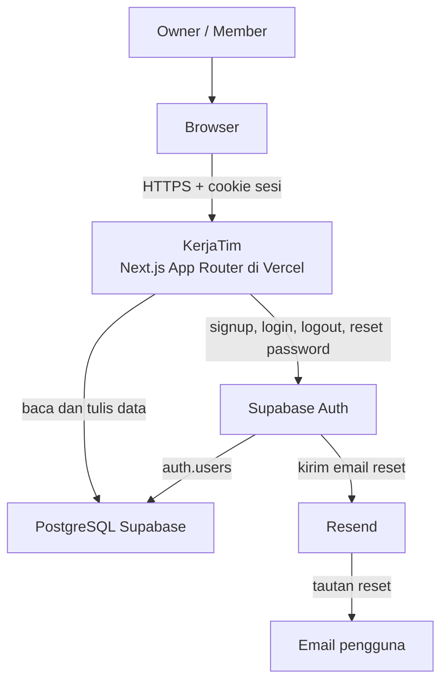
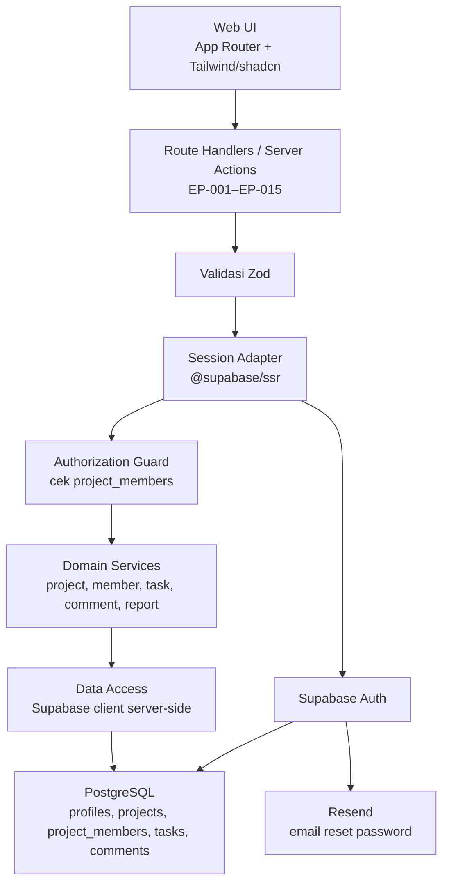
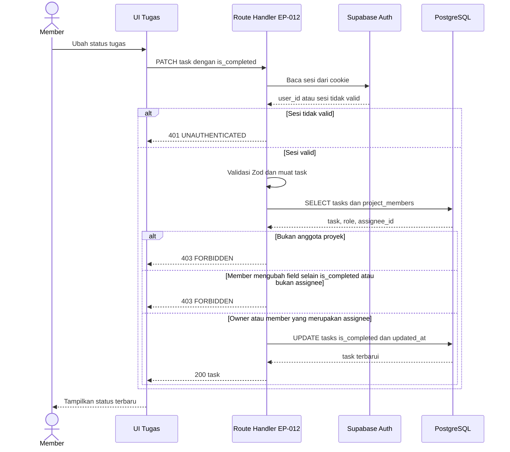
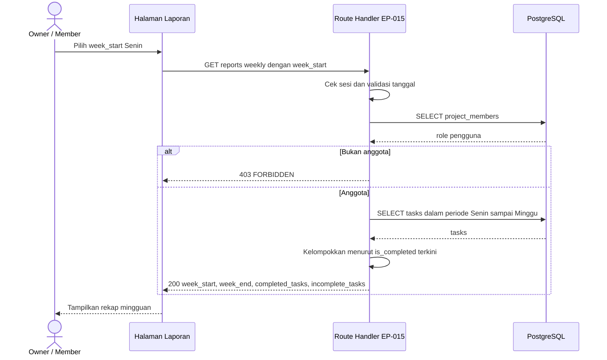
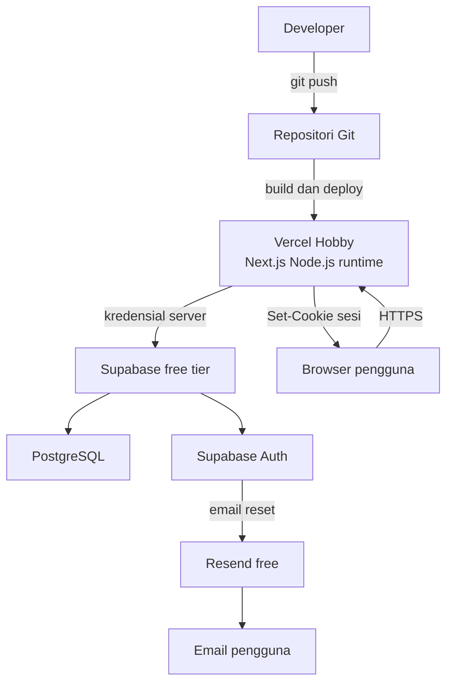

# ARCHITECTURE.md — KerjaTim

| Field | Nilai |
|---|---|
| Dokumen | ARCHITECTURE.md |
| Produk | KerjaTim |
| Sumber kebenaran | SpecModel proyek KerjaTim |
| Gaya arsitektur | Modular monolith full-stack |
| Runtime | Next.js App Router di Node.js, Vercel Hobby |
| Database | PostgreSQL di Supabase free tier |
| Auth | Supabase Auth email/password dengan cookie SSR (`@supabase/ssr`) |
| Entity | `profiles`, `projects`, `project_members`, `tasks`, `comments` |
| Endpoint | `EP-001`–`EP-015` |
| Requirement | `REQ-001`–`REQ-017`, `BR-001`–`BR-006` |
| Dependensi | `DATABASE.md`, `API.md`, `REQUIREMENTS.md`, `BUSINESS_RULES.md` |

Dokumen ini menjelaskan komponen, aliran data, deployment, dan tradeoff arsitektur KerjaTim. Seluruh entity, endpoint, role, requirement, dan aturan mengikuti SpecModel. Dokumen ini tidak menambahkan layanan, tabel, endpoint, atau role baru di luar SpecModel.

## 1. Architecture Overview

KerjaTim adalah aplikasi web manajemen tugas untuk tim kecil yang dijalankan sebagai **satu aplikasi Next.js full-stack**. Next.js App Router melayani rendering UI sekaligus Route Handlers/Server Actions untuk operasi `EP-001`–`EP-015`. Tidak ada backend service terpisah, queue, worker, atau layanan pembayaran. Persistensi berada di PostgreSQL Supabase, identitas pengguna dikelola Supabase Auth, dan email reset password dikirim melalui Resend.

Pemisahan tanggung jawab di dalam monolith tetap eksplisit:

1. **Web UI** merender halaman dan form, tanpa menyimpan role sebagai sumber kebenaran.
2. **Route Handlers/Server Actions** menjadi batas HTTP dan mutasi, dengan status `400`, `401`, `403`, `404`, `409`, `200`, `201`, `202`, atau `204` sesuai kontrak `API.md`.
3. **Validation layer** memeriksa body, path, dan query menggunakan Zod sebelum data menyentuh database.
4. **Session adapter** membaca sesi dari cookie melalui Supabase Auth.
5. **Authorization guard** memeriksa keanggotaan dan role per proyek dari `project_members`.
6. **Domain services** menjalankan aturan proyek, anggota, tugas, komentar, dan laporan.
7. **Data access layer** menjalankan query dan transaksi ke PostgreSQL.
8. **PostgreSQL** menyimpan `profiles`, `projects`, `project_members`, `tasks`, dan `comments`.

Prinsip arsitektur yang mengikat:

- **Server adalah satu-satunya enforcement point.** Role `owner` dan `member` tidak pernah dipercaya dari client. Setiap endpoint terproteksi memuat `project_members` berdasarkan `project_id` dan `user_id` dari sesi (`REQ-015`, `BR-002`).
- **Kepemilikan proyek memiliki satu sumber kebenaran.** Owner disimpan sebagai `project_members.role = 'owner'`, bukan sebagai `projects.owner_id` (`BR-001`). Transfer kepemilikan mengubah owner lama menjadi `member` dan owner baru menjadi `owner` dalam satu transaksi (`REQ-009`).
- **Aplikasi bersifat stateless.** State sesi berada di cookie HttpOnly, sedangkan state bisnis berada di PostgreSQL. Tidak ada state role di memori proses atau `localStorage`.
- **Laporan dihitung saat dibaca.** Tidak ada tabel `weekly_reports`, cron, atau snapshot terjadwal. `EP-015` menghitung laporan langsung dari `tasks` (`REQ-014`, `BR-005`).
- **Penghapusan mengikuti ownership data.** Menghapus tugas menghapus komentar terkait; mengeluarkan member tidak menghapus tugas maupun komentar (`REQ-008`, `REQ-012`, `BR-004`).

Di luar cakupan arsitektur MVP: pembayaran, notifikasi, lampiran file, undangan email, integrasi pihak ketiga, multi-workspace, dan verifikasi email yang belum diputuskan. Tidak ada endpoint untuk fitur-fitur tersebut di SpecModel.

## 2. System Context

Aktor dan sistem eksternal:

| Pihak | Peran | Batas kepercayaan | ID terkait |
|---|---|---|---|
| Owner | Membuat proyek, mengelola anggota, mengubah/menghapus tugas, transfer kepemilikan | Tidak dipercaya; semua aksi diverifikasi server | `REQ-004`–`REQ-012`, `REQ-015` |
| Member | Membuat tugas, mengubah status tugas miliknya, berkomentar, melihat laporan | Tidak dipercaya; role dibaca dari database | `REQ-010`–`REQ-014` |
| Browser | Menampilkan UI dan mengirim cookie sesi | Tidak dipercaya | `REQ-002`, `REQ-015` |
| Next.js server | Menjalankan UI, validasi, otorisasi, dan query | Dipercaya; memegang kredensial server | `EP-001`–`EP-015` |
| Supabase Auth | Menyimpan kredensial, membuat sesi, mengirim tautan reset | Dipercaya untuk identitas | `EP-001`–`EP-004`, `REQ-001`–`REQ-003` |
| PostgreSQL | Menyimpan seluruh data aplikasi | Dipercaya; RLS sebagai lapisan tambahan | Semua entity |
| Resend | Mengirim email reset password | Dipercaya untuk pengiriman email | `EP-004`, `REQ-003` |
| Vercel | Menjalankan aplikasi Next.js | Platform deployment | `EP-001`–`EP-015` |

Batas kepercayaan utama berada di browser. Server tidak menerima `role`, `user_id` pelaku, `author_id`, atau `owner_id` dari client. `EP-002` menetapkan cookie sesi; token tidak dikembalikan di body dan tidak disimpan di `localStorage`. Cookie wajib `HttpOnly`, `Secure`, dan `SameSite=Lax`.

## 3. Components

| Komponen | Tanggung jawab | ID terkait |
|---|---|---|
| Web UI | Halaman daftar proyek, detail proyek, tugas, komentar, laporan mingguan; form dan tampilan status | `REQ-005`, `REQ-014`, `REQ-016` |
| Route Handlers/Server Actions | Kontrak HTTP, status code, orkestrasi service | `EP-001`–`EP-015` |
| Validation layer | Validasi body, path, query, dan tipe data | `REQ-001`, `REQ-006`, `REQ-010`, `REQ-013` |
| Session adapter | Membaca, menyegarkan, dan menghapus sesi cookie | `REQ-002`, `REQ-003`, `REQ-015` |
| Authorization guard | Cek keanggotaan dan role per proyek sebelum aksi | `REQ-015`, `BR-001`, `BR-002`, `BR-003` |
| Project service | Proyek, anggota, pengeluaran member, transfer kepemilikan | `REQ-004`–`REQ-009` |
| Task service | Pembuatan, perubahan, penghapusan tugas | `REQ-010`–`REQ-012` |
| Comment service | Komentar kronologis pada tugas | `REQ-013` |
| Report service | Agregasi laporan mingguan dari `tasks` | `REQ-014`, `BR-005` |
| Data access | Query, join, dan transaksi ke PostgreSQL | Semua entity |
| PostgreSQL | Persistensi dan constraint | `DATABASE.md` |
| Email delivery | Pengiriman tautan reset melalui Supabase Auth dan Resend | `EP-004`, `REQ-003` |

**3.1 Web UI.** UI memakai Next.js App Router, TypeScript, Tailwind, dan shadcn. Server Components dipakai untuk pembacaan data, sedangkan Client Components menangani form dan interaksi. UI tidak menentukan role; ia hanya menampilkan aksi yang diizinkan berdasarkan respons server. Dengan demikian, menyembunyikan tombol bukan mekanisme otorisasi.

**3.2 Route Handlers/Server Actions.** Semua operasi mengikuti kontrak `API.md`. Server Actions yang dipakai form UI memanggil service domain yang sama dan melewati authorization guard yang sama; Server Actions bukan jalur alternatif yang melewati otorisasi. Tidak ada endpoint di luar `EP-001`–`EP-015`.

**3.3 Validation layer.** Zod memvalidasi input di server. Contoh aturan: email valid dan unik (`REQ-001`), password minimal 8 karakter (`REQ-001`), `name` proyek tidak kosong (`REQ-006`), `assignee_id` harus anggota proyek (`REQ-010`), `body` komentar tidak kosong (`REQ-013`), dan `week_start` adalah hari Senin (`EP-015`). Input tidak valid menghasilkan `400`.

**3.4 Session adapter.** Supabase Auth menangani signup, login, logout, dan reset password. `EP-001` membuat akun Auth dan baris `profiles` dengan `id` yang sama. `EP-002` membuat sesi cookie. `EP-003` menghapus cookie. `EP-004` meminta Supabase Auth mengirim tautan reset; aplikasi tidak menyimpan token reset sendiri. Pembuatan akun Auth dan profil aplikasi harus diperlakukan sebagai satu unit agar tidak ada akun Auth tanpa profil.

**3.5 Authorization guard.** Urutan pemeriksaan: sesi → validasi input → tentukan `project_id` dari path atau dari `task_id` → cek baris `project_members` untuk `(project_id, user_id)` → cek role sesuai aksi. Tanpa sesi menghasilkan `401`; bukan anggota menghasilkan `403`; resource yang tidak ada menghasilkan `404`; role yang tidak berwenang menghasilkan `403`. Untuk `EP-012`, member hanya boleh mengirim `is_completed` pada tugas dengan `assignee_id` dirinya (`BR-003`, `REQ-011`).

**3.6 Domain services.** Project service menangani `EP-005`–`EP-010`, termasuk pencocokan email persis tanpa menampilkan daftar pengguna (`BR-006`, `REQ-007`) dan larangan owner mengeluarkan dirinya sendiri (`REQ-008`). Task service menangani `EP-011`–`EP-013`. Comment service menangani `EP-014`. Report service menangani `EP-015`. Pemisahan ini menjaga aturan bisnis tetap di satu tempat dan dapat diuji per requirement.

**3.7 Data access dan PostgreSQL.** Data access memakai Supabase client di server. Constraint utama: `profiles.email` unik; pasangan `(project_id, user_id)` unik di `project_members`; tepat satu owner per proyek dijaga dengan indeks unik parsial untuk `role = 'owner'`; `tasks.assignee_id` merujuk `profiles.id`; `comments.task_id` memakai cascade delete. `projects.updated_at` dan `tasks.updated_at` diperbarui trigger. RLS Supabase diaktifkan sebagai lapisan pertahanan tambahan, bukan pengganti guard aplikasi.

**3.8 Email delivery.** Resend hanya dipakai untuk email reset password melalui Supabase Auth (`EP-004`). Tidak ada email notifikasi, undangan, atau pengingat dalam MVP karena fitur tersebut tidak ada di SpecModel.

## 4. Data Flow

### 4.1 Siklus request umum

1. Browser mengirim request HTTPS dengan cookie sesi.
2. Session adapter membaca cookie dan memvalidasi sesi. Endpoint `auth: true` tanpa sesi valid menghasilkan `401` (`REQ-015`).
3. Validation layer memeriksa body, path, dan query. Input tidak valid menghasilkan `400`.
4. `project_id` ditentukan dari path, atau diturunkan dari `task_id` untuk endpoint tugas dan komentar. `project_id` tidak diterima dari body.
5. Authorization guard memuat `project_members`. Tidak ada baris keanggotaan menghasilkan `403`.
6. Guard memeriksa role sesuai aksi: aksi owner ditolak untuk member; perubahan status oleh member dibatasi pada tugas miliknya (`BR-003`).
7. Domain service menjalankan query atau mutasi. Mutasi memperbarui `updated_at` bila relevan.
8. Respons mengembalikan resource langsung tanpa envelope `data`, atau error dengan bentuk `{ error: { code, message, details } }`.

### 4.2 Autentikasi dan reset password

- **Signup `EP-001`:** validasi email, password, dan `display_name`; buat akun Supabase Auth; buat `profiles` dengan `id` yang sama. Email duplikat menghasilkan `409`.
- **Login `EP-002`:** Supabase Auth memverifikasi kredensial. Kredensial benar membuat sesi cookie dan mengarahkan pengguna ke halaman proyek; kredensial salah menghasilkan `401` tanpa sesi (`REQ-002`).
- **Logout `EP-003`:** cookie sesi dihapus dan endpoint terproteksi berikutnya menghasilkan `401`.
- **Lupa password `EP-004`:** permintaan selalu menghasilkan `202` dengan pesan netral. Jika email terdaftar, Supabase Auth mengirim tautan reset melalui Resend. Email tidak terdaftar tidak membocorkan status akun (`REQ-003`).

### 4.3 Proyek dan keanggotaan

- **`EP-006`:** membuat `projects` dan baris `project_members` role `owner` untuk pembuat dalam satu transaksi. Proyek tanpa owner tidak boleh terbentuk (`REQ-004`, `BR-001`).
- **`EP-005`:** mengambil proyek tempat pengguna menjadi anggota, termasuk `role` dan `member_count`. Proyek yang tidak diikuti tidak muncul (`REQ-005`).
- **`EP-007`:** hanya untuk anggota. Respons memuat `project`, `members`, `tasks` beserta `comments`. Komentar diurutkan kronologis berdasarkan `created_at` lalu `id`. Query `q`, `status`, dan `assignee_id` didukung kontrak; prioritas `REQ-016` adalah later.
- **`EP-008`:** hanya owner. Perubahan `name`/`description` dan transfer kepemilikan. `new_owner_id` harus anggota aktif. Transfer menurunkan owner lama menjadi `member` dan menaikkan owner baru menjadi `owner` dalam satu transaksi (`REQ-009`).
- **`EP-009`:** hanya owner. Sistem mencocokkan `profiles.email` secara persis tanpa menampilkan daftar pengguna. Email tidak ditemukan menghasilkan `404`; sudah menjadi anggota menghasilkan `409` (`REQ-007`, `BR-006`).
- **`EP-010`:** hanya owner dan tidak boleh untuk dirinya sendiri. Baris `project_members` dihapus; `tasks` dan `comments` tetap ada, dan `display_name` penulis tetap tampil dari `profiles` (`REQ-008`, `BR-004`).

### 4.4 Tugas

- **`EP-011`:** anggota proyek dapat membuat tugas dengan `title`, `description`, dan `assignee_id`. `assignee_id` wajib anggota proyek; jika tidak, `400`. Tugas baru memiliki `is_completed = false` (`REQ-010`).
- **`EP-012`:** owner dapat mengubah `title`, `description`, `assignee_id`, dan `is_completed`. Member hanya dapat mengirim `is_completed` untuk tugas dengan `assignee_id` dirinya. Field lain atau tugas milik anggota lain menghasilkan `403` (`REQ-011`, `BR-003`). Perubahan status memperbarui `updated_at`.
- **`EP-013`:** hanya owner. Penghapusan tugas menghapus komentar terkait melalui cascade (`REQ-012`).

### 4.5 Komentar

`EP-014` menerima `body` non-kosong dari anggota proyek. `author_id` diambil dari sesi, bukan dari client. Komentar menyimpan `created_at` dan ditampilkan kronologis bersama `display_name` (`REQ-013`). Non-anggota mendapat `403`.

### 4.6 Laporan mingguan

`EP-015` menerima `week_start` hari Senin. Server menghitung `week_end` sebagai Minggu, lalu mengambil tugas pada proyek yang `created_at` atau `updated_at` berada dalam periode tersebut. Setiap tugas dihitung sekali dan dikelompokkan berdasarkan `is_completed` terkini menjadi `completed_tasks` dan `incomplete_tasks` (`REQ-014`, `BR-005`). Laporan tidak disimpan dan tidak memakai snapshot historis.

| State | Lokasi | Sifat |
|---|---|---|
| Sesi | Cookie HttpOnly | Per browser, diverifikasi server |
| Role owner/member | `project_members` | Per proyek, sumber kebenaran |
| Data proyek, tugas, komentar | PostgreSQL | Persisten |
| Hasil laporan mingguan | Dihitung saat request | Tidak disimpan |

### 4.7 Pemetaan status error

| Status | Kondisi |
|---|---|
| `400` | Validasi gagal, `name` kosong, `assignee_id` bukan anggota, `body` kosong, `week_start` tidak valid |
| `401` | Tanpa sesi valid pada endpoint terproteksi |
| `403` | Bukan anggota proyek atau role tidak berwenang |
| `404` | Resource tidak ditemukan atau email tidak cocok |
| `409` | Email sudah terdaftar atau pengguna sudah menjadi anggota |
| `202` | Permintaan reset password diterima |
| `204` | Logout, hapus member, atau hapus tugas berhasil |

## 5. Sequence Diagram

### 5.1 Member mengubah status tugas (`EP-012`)

Diagram ini menunjukkan `BR-003` dan `REQ-011`: keputusan otorisasi terjadi setelah sesi dan data tugas dimuat, bukan di client. Owner melewati pembatasan field; member tidak.

### 5.2 Laporan mingguan (`EP-015`)

Laporan tidak memakai job terjadwal. Konsekuensinya, perubahan status setelah minggu berjalan dapat mengubah hasil laporan untuk minggu tersebut karena `updated_at` ikut dipertimbangkan. Ini konsekuensi langsung dari `BR-005`.

## 6. Deployment

Topologi produksi terdiri dari tiga layanan terkelola:

| Lapisan | Layanan | Tanggung jawab |
|---|---|---|
| Aplikasi | Vercel Hobby | Build dan jalankan Next.js, Route Handlers, SSR |
| Database | Supabase free tier | PostgreSQL, constraint, RLS, migrasi |
| Auth | Supabase Auth | Akun, sesi, reset password |
| Email | Resend free | Pengiriman tautan reset via Supabase Auth |

Konfigurasi server mencakup Supabase URL, anon key, service role key, kunci Resend, dan base URL aplikasi. Anon key boleh tersedia di client; service role key hanya boleh berada di environment server dan tidak pernah dikirim ke browser. Kredensial tidak disimpan di repositori.

Migrasi database dijalankan sebagai SQL migration ke Supabase, mencakup pembuatan tabel, foreign key, unique constraint, indeks unik parsial owner, indeks foreign key, trigger `updated_at`, dan policy RLS. Detail skema mengikuti `DATABASE.md`; arsitektur tidak menduplikasi definisi field.

Karakteristik operasional:

- **Stateless.** Instance Vercel tidak menyimpan state bisnis. Semua request membawa cookie sesi dan membaca PostgreSQL.
- **Tanpa background worker.** Tidak ada cron, queue, atau job laporan. `EP-015` dihitung on-demand.
- **Tanpa cache store terpisah.** Sumber data selalu PostgreSQL; konsistensi lebih penting daripada latency pada skala tim kecil.
- **Build dan runtime Node.js.** Route Handlers memakai runtime Node.js agar kompatibel dengan Supabase client dan Zod.
- **Free tier.** Vercel Hobby, Supabase free tier, dan Resend free memberi biaya awal rendah, dengan batas kuota yang perlu dipantau. Jika kuota atau volume data meningkat, jalur peningkatan adalah menaikkan paket layanan tanpa mengubah model aplikasi.

Deployment tidak memerlukan container, load balancer, atau konfigurasi DNS khusus di luar domain yang disediakan platform. Logout dan kedaluwarsa sesi ditangani Supabase Auth; aplikasi tidak menyimpan token reset.

## 7. Tradeoffs

| Keputusan | Alternatif | Tradeoff | Mitigasi |
|---|---|---|---|
| Modular monolith Next.js | Backend terpisah atau SvelteKit | Deploy sederhana dan tipe shared, tetapi UI dan API terikat satu codebase serta satu siklus rilis | Batas modul domain, kontrak `API.md`, validasi Zod |
| Supabase Auth | Better Auth + Drizzle | Permukaan keamanan lebih kecil dan reset password teruji, tetapi ada ketergantungan vendor dan kontrol alur lebih terbatas | Profil aplikasi tetap di `profiles`; role tidak bergantung pada Auth |
| PostgreSQL Supabase | Neon + Drizzle | Terkelola dan terintegrasi dengan Auth, tetapi kontrol tooling dan kuota free tier lebih terbatas | Migrasi SQL eksplisit, skema terdokumentasi |
| Vercel Hobby | Railway atau Fly.io | Tanpa operasi container, tetapi runtime dan batas platform membatasi kontrol | Handler stateless, tanpa local disk, tanpa worker |
| Owner sebagai `project_members.role` | Kolom `projects.owner_id` | Satu sumber kebenaran dan transfer atomik, tetapi setiap pembacaan butuh join dan constraint tambahan | Indeks unik parsial owner, transaksi transfer |
| Otorisasi di aplikasi + RLS | RLS saja atau cek di client | Guard aplikasi menghasilkan error yang jelas dan dapat diuji per requirement, tetapi logika RLS dan aplikasi harus konsisten | Predikat sama, test otorisasi per `REQ-015` |
| Laporan dihitung on-read | Tabel snapshot atau materialized view | Tidak ada drift dan tidak ada job, tetapi biaya query tumbuh dan status historis tidak tersimpan | Indeks timestamp, periode dibatasi, evaluasi ulang bila volume meningkat |
| Sesi cookie SSR | Token di `localStorage` | Lebih aman terhadap XSS dan cocok untuk SSR, tetapi memerlukan disiplin cookie dan SameSite | `HttpOnly`, `Secure`, `SameSite=Lax` |
| Tanpa pagination pada kontrak MVP | Pagination sejak awal | Klien lebih sederhana, tetapi respons detail proyek dapat membesar | Batas ukuran respons dipantau; lihat Open Questions |

Tradeoff terbesar ada pada **satu deployable unit**. Monolith mempercepat MVP dan menghilangkan sinkronisasi kontrak antar-layanan, tetapi membuat UI, otorisasi, dan query berbagi proses yang sama. Karena itu, pemisahan domain service dan guard bukan formalitas: ia mencegah aturan `BR-001`–`BR-006` tersebar di handler. Jika aturan tersebar, perubahan pada `BR-003` berisiko tidak konsisten antara `EP-012` dan tampilan UI.

Tradeoff kedua adalah **ketergantungan pada Supabase**. Auth, database, dan sesi berada dalam satu vendor. Keuntungannya, alur login, cookie SSR, dan reset password tidak perlu dibangun sendiri. Kerugiannya, migrasi keluar memerlukan pemetaan `auth.users` ke penyedia identitas lain dan penyesuaian adapter sesi. Karena role bisnis tidak disimpan di Supabase Auth, dampak migrasi terbatas pada identitas, bukan model otorisasi proyek.

Tradeoff ketiga adalah **laporan berbasis status terkini**. Ini memenuhi `BR-005`, tetapi laporan bukan arsip historis. Tugas yang dibuat minggu lalu dan diselesaikan minggu ini muncul di laporan minggu ini dengan status selesai. Tugas yang dibuat dan diperbarui pada minggu yang sama dihitung sekali. Jika kelak dibutuhkan laporan yang merekam status pada akhir minggu, arsitektur harus menambah snapshot atau event history; hal itu tidak ada di SpecModel dan tidak boleh diasumsikan sekarang.

Tradeoff keempat adalah **data historis setelah member dikeluarkan**. `BR-004` mempertahankan tugas dan komentar, sehingga laporan dan daftar tugas tetap menampilkan `display_name` mantan member. Konsekuensinya, tugas yang masih menunjuk mantan member tetap terbuka sampai owner mengganti `assignee_id`. Ini keputusan produk yang tercatat di Open Questions, bukan perilaku yang boleh ditebak implementasinya.

## Open Questions

1. **Zona waktu laporan mingguan.** SpecModel belum menetapkan zona waktu; usulan Asia/Jakarta perlu dikonfirmasi. Pilihan ini menentukan batas `week_start` dan `week_end` pada `EP-015` serta konsistensi `BR-005`.
2. **Verifikasi email saat signup.** Apakah Supabase Auth mewajibkan verifikasi sebelum akun dapat login, atau akun langsung aktif setelah `EP-001`? Ini memengaruhi kapan `EP-002` boleh membuat sesi.
3. **Edit atau hapus komentar.** SpecModel belum memutuskan apakah komentar bersifat permanen. Saat ini tidak ada endpoint edit/hapus komentar; jika ditambahkan, guard dan model data perlu diperluas.
4. **Tugas milik mantan member.** Setelah `EP-010`, apakah tugas yang masih menunjuk mantan member tetap terbuka sampai owner mengganti `assignee_id`, atau penanganan lain? `BR-004` menyatakan data tetap ada, tetapi perilaku produk belum final.
5. **Batas ukuran respons dan pagination.** Kontrak MVP tidak memakai pagination. Perlu ditetapkan ambang volume proyek/tugas/komentar yang memicu pagination agar `EP-007` tetap dapat diuji pada data besar.