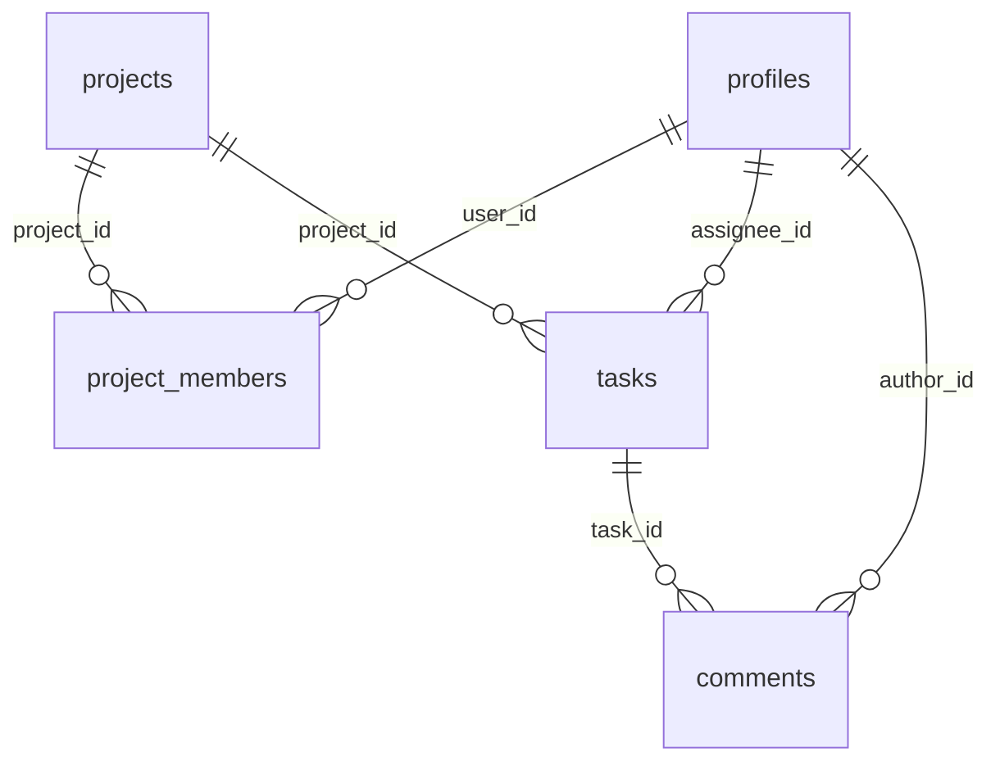

# DATABASE.md — KerjaTim

| Field | Nilai |
|---|---|
| Dokumen | DATABASE.md |
| Produk | KerjaTim |
| Database | PostgreSQL (Supabase) |
| Sumber kebenaran | SpecModel proyek KerjaTim |
| Entity | `profiles`, `projects`, `project_members`, `tasks`, `comments` |
| Auth | Supabase Auth; `profiles.id` sama dengan `auth.users.id` |
| Requirement terkait | `REQ-001`–`REQ-017`, `BR-001`–`BR-006` |
| Endpoint terkait | `EP-001`–`EP-015` |

Dokumen ini mendefinisikan entity, field, relasi, index, dan constraint untuk database KerjaTim. SpecModel adalah satu-satunya sumber kebenaran. Dokumen ini tidak menambahkan entity, endpoint, role, requirement, atau aturan produk baru di luar SpecModel. Nama entity dan ID kanonik mengikuti SpecModel serta `REQUIREMENTS.md`.

## 1. Data Model Overview

KerjaTim memakai model data relasional dengan lima tabel aplikasi: `profiles`, `projects`, `project_members`, `tasks`, dan `comments`. Tabel `auth.users` dikelola Supabase Auth dan tidak diduplikasi; `profiles` menyimpan data aplikasi yang diperlukan untuk email, nama tampilan, dan relasi ke tugas/komentar.

Kepemilikan proyek tidak disimpan sebagai `projects.owner_id`. Sumber kebenaran kepemilikan adalah `project_members.role = 'owner'`, dengan tepat satu owner per proyek (`BR-001`). Role bersifat per proyek, sehingga satu pengguna dapat menjadi `owner` di proyek A dan `member` di proyek B (`BR-002`).

| Entity | Fungsi | Primary key | Relasi utama | Requirement |
|---|---|---|---|---|
| `profiles` | Profil aplikasi per pengguna Auth; menyimpan email dan `display_name` | `id` | 1:1 ke `auth.users`; 1:N ke `project_members`, `tasks`, `comments` | `REQ-001`, `REQ-002`, `REQ-003`, `REQ-007` |
| `projects` | Proyek yang menaungi anggota, tugas, komentar, dan laporan | `id` | 1:N ke `project_members`, `tasks` | `REQ-004`–`REQ-006`, `REQ-009`, `REQ-014` |
| `project_members` | Keanggotaan dan role pengguna per proyek | `id` | N:1 ke `projects` dan `profiles` | `REQ-004`, `REQ-007`–`REQ-009`, `REQ-015` |
| `tasks` | Tugas proyek dengan assignee dan status selesai/belum selesai | `id` | N:1 ke `projects`; N:1 ke `profiles` sebagai assignee; 1:N ke `comments` | `REQ-010`–`REQ-012`, `REQ-014`, `REQ-016`, `REQ-017` |
| `comments` | Komentar kronologis pada tugas | `id` | N:1 ke `tasks`; N:1 ke `profiles` sebagai author | `REQ-013`, `REQ-012` |



Prinsip implementasi:

- Semua primary key memakai `uuid`. `profiles.id` tidak memakai default karena harus sama dengan `auth.users.id`.
- Semua timestamp disimpan sebagai `timestamptz` dalam UTC. Batas minggu laporan dihitung di server, bukan disimpan sebagai kolom.
- Tidak ada soft delete. Penghapusan tugas menghapus komentar terkait melalui foreign key cascade (`REQ-012`, `EP-013`).
- Laporan mingguan bukan tabel dan bukan materialized view; laporan dihitung dari `tasks` saat dibaca (`REQ-014`, `BR-005`).
- Tidak ada tabel pembayaran, notifikasi, lampiran file, undangan email, atau multi-workspace pada MVP.

## 2. Entities

### 2.1 `profiles`

`profiles` menyimpan profil aplikasi untuk setiap pengguna Supabase Auth. `id` adalah primary key sekaligus foreign key ke `auth.users(id)`. Password tidak disimpan di tabel ini. `email` unik dan dipakai untuk login serta pencocokan persis saat owner menambahkan member (`EP-009`, `BR-006`). `display_name` dipakai pada daftar anggota dan komentar (`REQ-013`).

Profil dibuat saat signup (`REQ-001`, `EP-001`). Tidak ada endpoint ubah profil pada SpecModel, sehingga `profiles` tidak memiliki `updated_at`.

### 2.2 `projects`

`projects` adalah aggregate root untuk tugas, komentar, dan keanggotaan. Field yang tersedia hanya `id`, `name`, `description`, `created_at`, dan `updated_at`. Nama wajib tidak kosong (`REQ-006`). Deskripsi wajib tersimpan sebagai `text` dan boleh berupa string kosong.

Tidak ada kolom `owner_id`, `status`, `archived_at`, atau `deleted_at`. Tidak ada endpoint hapus proyek pada `EP-001`–`EP-015`.

### 2.3 `project_members`

`project_members` menyimpan relasi pengguna dengan proyek beserta role `owner` atau `member`. Setiap pasangan `(project_id, user_id)` unik. Tepat satu baris dengan `role = 'owner'` harus ada per proyek (`BR-001`). Perpindahan kepemilikan mengubah owner lama menjadi `member` dan owner baru menjadi `owner` dalam satu transaksi (`REQ-009`).

Menghapus baris `project_members` tidak menghapus tugas atau komentar. Ini disengaja untuk memenuhi `BR-004` dan `REQ-008`: mantan member kehilangan akses, tetapi data historis dan `display_name` penulis tetap tersedia.

### 2.4 `tasks`

`tasks` menyimpan tugas dalam satu proyek. Setiap tugas memiliki `project_id`, `title`, `description`, `assignee_id`, `is_completed`, `created_at`, dan `updated_at`. Status default adalah `false` atau belum selesai (`REQ-010`). Assignee harus merupakan anggota proyek pada saat tugas dibuat atau saat `assignee_id` diubah (`REQ-010`, `REQ-011`).

Tidak ada field `due_date`, `priority`, `attachment`, atau `deleted_at` karena tidak ada di SpecModel. Tugas yang masih menunjuk mantan member tetap tersimpan setelah member dikeluarkan; owner perlu menetapkan assignee baru (`BR-004`).

### 2.5 `comments`

`comments` menyimpan komentar teks pada tugas. Setiap komentar memiliki `task_id`, `author_id`, `body`, dan `created_at`. `body` tidak boleh kosong atau hanya whitespace (`REQ-013`). Komentar ditampilkan kronologis berdasarkan `created_at` lalu `id` sebagai tie-breaker.

Tidak ada `updated_at` atau `deleted_at`. Komentar hanya terhapus ketika tugas induk dihapus oleh owner (`REQ-012`, `EP-013`). Apakah komentar boleh diedit atau dihapus langsung belum diputuskan di SpecModel dan dicatat di Open Questions.

### 2.6 Objek yang tidak dimodelkan

`weekly_reports`, `invitations`, `notifications`, `attachments`, `payments`, dan `workspaces` tidak dibuat sebagai tabel karena tidak ada di SpecModel. Laporan mingguan adalah hasil query terhadap `tasks`. Penambahan member memakai pencarian `profiles.email` persis, bukan tabel undangan. Notifikasi, lampiran file, pembayaran, dan multi-workspace berada di luar cakupan MVP.

## 3. Fields & Types

Konvensi tipe:

- `uuid` untuk seluruh primary key dan foreign key.
- `timestamptz` untuk seluruh field bertipe `timestamp` di SpecModel.
- `text` tanpa batas panjang eksplisit. Validasi panjang dan format dilakukan di server dengan Zod.
- `boolean` hanya dipakai untuk `tasks.is_completed`.
- Semua field `required` di SpecModel menjadi `NOT NULL`. Tidak ada kolom nullable.
- Default `now()` dipakai untuk timestamp yang dibuat otomatis. `projects.updated_at` dan `tasks.updated_at` diperbarui oleh trigger.

### 3.1 `profiles`

| Field | Tipe | Null | Default | Constraint dan catatan |
|---|---|---|---|---|
| `id` | `uuid` | Tidak | — | Primary key; foreign key ke `auth.users(id)` `ON DELETE CASCADE`; harus sama dengan ID Auth. |
| `email` | `text` | Tidak | — | `UNIQUE`; format divalidasi Zod; dipakai `EP-009` dan `BR-006`. |
| `display_name` | `text` | Tidak | — | `CHECK` tidak kosong setelah `btrim`; tampil pada anggota dan komentar. |
| `created_at` | `timestamptz` | Tidak | `now()` | Waktu profil dibuat. |

### 3.2 `projects`

| Field | Tipe | Null | Default | Constraint dan catatan |
|---|---|---|---|---|
| `id` | `uuid` | Tidak | `gen_random_uuid()` | Primary key. |
| `name` | `text` | Tidak | — | `CHECK` tidak kosong setelah `btrim`; `REQ-006` menolak nama kosong. |
| `description` | `text` | Tidak | `''` | Boleh string kosong; `REQ-004` menyatakan deskripsi opsional pada permintaan. |
| `created_at` | `timestamptz` | Tidak | `now()` | Waktu proyek dibuat. |
| `updated_at` | `timestamptz` | Tidak | `now()` | Diperbarui trigger `set_updated_at` pada setiap `UPDATE`. |

### 3.3 `project_members`

| Field | Tipe | Null | Default | Constraint dan catatan |
|---|---|---|---|---|
| `id` | `uuid` | Tidak | `gen_random_uuid()` | Primary key baris keanggotaan. |
| `project_id` | `uuid` | Tidak | — | Foreign key ke `projects(id)`; bagian dari unique `(project_id, user_id)`. |
| `user_id` | `uuid` | Tidak | — | Foreign key ke `profiles(id)`; bagian dari unique `(project_id, user_id)`. |
| `role` | `text` | Tidak | — | `CHECK (role IN ('owner', 'member'))`; partial unique index menjaga maksimal satu owner. |
| `joined_at` | `timestamptz` | Tidak | `now()` | Waktu pengguna bergabung ke proyek. |

### 3.4 `tasks`

| Field | Tipe | Null | Default | Constraint dan catatan |
|---|---|---|---|---|
| `id` | `uuid` | Tidak | `gen_random_uuid()` | Primary key. |
| `project_id` | `uuid` | Tidak | — | Foreign key ke `projects(id)`; tidak dapat diubah setelah insert. |
| `title` | `text` | Tidak | — | `CHECK` tidak kosong setelah `btrim`. |
| `description` | `text` | Tidak | `''` | Boleh string kosong. |
| `assignee_id` | `uuid` | Tidak | — | Foreign key ke `profiles(id)`; harus anggota proyek saat insert atau saat assignee diubah (`REQ-010`). |
| `is_completed` | `boolean` | Tidak | `false` | Status tugas; `REQ-011`, `REQ-014`. |
| `created_at` | `timestamptz` | Tidak | `now()` | Waktu tugas dibuat; dipakai laporan (`BR-005`). |
| `updated_at` | `timestamptz` | Tidak | `now()` | Diperbarui trigger; dipakai laporan (`BR-005`). |

### 3.5 `comments`

| Field | Tipe | Null | Default | Constraint dan catatan |
|---|---|---|---|---|
| `id` | `uuid` | Tidak | `gen_random_uuid()` | Primary key. |
| `task_id` | `uuid` | Tidak | — | Foreign key ke `tasks(id)` `ON DELETE CASCADE`; `REQ-012`, `EP-013`. |
| `author_id` | `uuid` | Tidak | — | Foreign key ke `profiles(id)`; harus anggota proyek saat insert (`REQ-013`). |
| `body` | `text` | Tidak | — | `CHECK` tidak kosong setelah `btrim`; `REQ-013` menolak body kosong. |
| `created_at` | `timestamptz` | Tidak | `now()` | Urutan kronologis bersama `id`. |

## 4. Relationships

| Dari | Ke | Kardinalitas | Foreign key | On delete | Catatan |
|---|---|---|---|---|---|
| `auth.users` | `profiles` | 1:1 | `profiles.id` | `CASCADE` | Profil mengikuti ID Auth; penghapusan akun tidak diekspos oleh API. |
| `profiles` | `project_members` | 1:N | `project_members.user_id` | `RESTRICT` | Profil dengan keanggotaan tidak dapat dihapus sebelum keanggotaan dibersihkan. |
| `projects` | `project_members` | 1:N | `project_members.project_id` | `CASCADE` | Tidak ada endpoint hapus proyek pada MVP. |
| `projects` | `tasks` | 1:N | `tasks.project_id` | `CASCADE` | Tugas selalu milik satu proyek. |
| `profiles` | `tasks` | 1:N | `tasks.assignee_id` | `RESTRICT` | Assignee harus anggota proyek saat penugasan; data historis tetap ada setelah member dikeluarkan. |
| `tasks` | `comments` | 1:N | `comments.task_id` | `CASCADE` | Menghapus tugas menghapus komentar terkait (`REQ-012`). |
| `profiles` | `comments` | 1:N | `comments.author_id` | `RESTRICT` | Nama penulis tetap tampil setelah member dikeluarkan (`BR-004`). |

Invariant lintas tabel:

1. **Tepat satu owner per proyek (`BR-001`).** Partial unique index menjamin maksimal satu owner; deferred constraint trigger menjamin minimal satu owner saat commit. Proyek harus dibuat dalam transaksi yang juga menyisipkan baris owner.
2. **Role per proyek (`BR-002`).** Tidak ada kolom role global. Setiap pemeriksaan otorisasi memakai pasangan `(project_id, user_id)`.
3. **Assignee harus anggota proyek saat penugasan (`REQ-010`).** Tidak memakai composite foreign key `tasks(project_id, assignee_id)` ke `project_members(project_id, user_id)` karena `BR-004`/`REQ-008` mengharuskan tugas tetap ada setelah member dikeluarkan. Validasi dilakukan server dan trigger pada insert atau perubahan `assignee_id`.
4. **Author komentar harus anggota proyek saat insert (`REQ-013`).** Tidak memakai composite foreign key ke `project_members` karena komentar harus tetap ada setelah author dikeluarkan. Validasi dilakukan server dan trigger insert.
5. **Mengeluarkan member tidak menghapus data (`BR-004`).** `DELETE` pada `project_members` hanya menghapus baris keanggotaan. Tugas dan komentar tetap menunjuk `profiles`, sehingga `display_name` tetap dapat ditampilkan.
6. **Transfer kepemilikan (`REQ-009`).** Owner lama diubah menjadi `member`, owner baru diubah menjadi `owner` dalam satu transaksi. Owner lama tetap menjadi anggota, bukan dihapus.
7. **Laporan mingguan (`REQ-014`, `BR-005`).** Query memakai `tasks.project_id`, `created_at`, `updated_at`, dan `is_completed` terkini. Tugas yang dibuat dan diperbarui pada minggu yang sama tetap muncul satu kali.

## 5. Indexes

| Nama index | Tabel | Kolom | Tipe | Tujuan |
|---|---|---|---|---|
| `profiles_pkey` | `profiles` | `id` | B-tree, primary key | Lookup profil dan foreign key. |
| `profiles_email_key` | `profiles` | `email` | B-tree, unique | `REQ-001`, `EP-009`, `BR-006`; mencegah email duplikat dan mempercepat pencocokan persis. |
| `projects_pkey` | `projects` | `id` | B-tree, primary key | Lookup proyek. |
| `project_members_pkey` | `project_members` | `id` | B-tree, primary key | Lookup baris keanggotaan. |
| `project_members_project_id_user_id_key` | `project_members` | `project_id`, `user_id` | B-tree, unique | Mencegah duplikasi anggota; mendukung daftar anggota per proyek. |
| `ux_project_members_one_owner` | `project_members` | `project_id` | B-tree, unique partial `WHERE role = 'owner'` | Menjamin maksimal satu owner per proyek (`BR-001`). |
| `idx_project_members_user_id` | `project_members` | `user_id` | B-tree | `EP-005`; daftar proyek milik pengguna dan pengecekan keanggotaan. |
| `tasks_pkey` | `tasks` | `id` | B-tree, primary key | Lookup tugas. |
| `idx_tasks_project_created_at` | `tasks` | `project_id`, `created_at` | B-tree | Laporan mingguan berdasarkan `created_at` (`BR-005`). |
| `idx_tasks_project_updated_at` | `tasks` | `project_id`, `updated_at` | B-tree | Laporan mingguan berdasarkan `updated_at` (`BR-005`). |
| `idx_tasks_project_status` | `tasks` | `project_id`, `is_completed` | B-tree | Filter status `REQ-016` dan pengelompokan laporan. |
| `idx_tasks_project_assignee` | `tasks` | `project_id`, `assignee_id` | B-tree | Filter assignee `REQ-016`; validasi assignee per proyek. |
| `idx_tasks_assignee_status` | `tasks` | `assignee_id`, `is_completed` | B-tree | Ringkasan tugas pribadi `REQ-017`; dibuat saat fitur `later` diaktifkan. |
| `idx_tasks_title_trgm` | `tasks` | `title` | GIN `gin_trgm_ops` | Pencarian judul `REQ-016`; memerlukan extension `pg_trgm`; dibuat saat fitur `later` diaktifkan. |
| `comments_pkey` | `comments` | `id` | B-tree, primary key | Lookup komentar. |
| `idx_comments_task_created_id` | `comments` | `task_id`, `created_at`, `id` | B-tree | Menampilkan komentar kronologis dan cascade lookup berdasarkan tugas. |
| `idx_comments_author_id` | `comments` | `author_id` | B-tree | Foreign key lookup dan pengecekan profil penulis. |

Catatan index:

- Index unik `profiles_email_key`, `project_members_project_id_user_id_key`, dan `ux_project_members_one_owner` sekaligus menjadi constraint.
- Query laporan mingguan memakai `OR` antara `created_at` dan `updated_at`. PostgreSQL dapat memakai bitmap `OR` dari `idx_tasks_project_created_at` dan `idx_tasks_project_updated_at`.
- Tidak ada index pada `description` atau `body` karena tidak ada requirement pencarian teks bebas pada field tersebut.
- Index `later` tidak dibuat pada migrasi MVP untuk menghindari overhead yang belum dibutuhkan.

## 6. Constraints

### 6.1 Nullability dan default

Semua kolom pada bagian 3 bersifat `NOT NULL`. `projects.description` dan `tasks.description` memakai default `''` agar tidak pernah `NULL` dan tetap mendukung string kosong. `tasks.is_completed` default `false`. Timestamp memakai default `now()`.

### 6.2 Primary key dan foreign key

| Constraint | Definisi | Aksi | Alasan |
|---|---|---|---|
| `profiles_pkey` | `PRIMARY KEY (id)` | — | Satu profil per pengguna Auth. |
| `profiles_id_fkey` | `profiles.id REFERENCES auth.users(id)` | `ON DELETE CASCADE` | Profil mengikuti siklus hidup akun Auth. |
| `project_members_project_id_fkey` | `project_members.project_id REFERENCES projects(id)` | `ON DELETE CASCADE` | Baris anggota mengikuti proyek. |
| `project_members_user_id_fkey` | `project_members.user_id REFERENCES profiles(id)` | `ON DELETE RESTRICT` | Mencegah hilangnya referensi keanggotaan secara tidak sengaja. |
| `tasks_project_id_fkey` | `tasks.project_id REFERENCES projects(id)` | `ON DELETE CASCADE` | Tugas mengikuti proyek. |
| `tasks_assignee_id_fkey` | `tasks.assignee_id REFERENCES profiles(id)` | `ON DELETE RESTRICT` | Menjaga nama assignee historis. |
| `comments_task_id_fkey` | `comments.task_id REFERENCES tasks(id)` | `ON DELETE CASCADE` | `REQ-012` dan `EP-013` menghapus komentar bersama tugas. |
| `comments_author_id_fkey` | `comments.author_id REFERENCES profiles(id)` | `ON DELETE RESTRICT` | Menjaga nama penulis historis (`BR-004`). |

Tidak ada foreign key dari `tasks` atau `comments` ke `project_members`. Ini keputusan sadar agar pengeluaran member tidak memblokir atau menghapus data historis.

### 6.3 Unique constraint

```sql
-- Email unik untuk login dan pencocokan EP-009.
ALTER TABLE profiles
  ADD CONSTRAINT profiles_email_key UNIQUE (email);

-- Satu pengguna hanya boleh memiliki satu baris keanggotaan per proyek.
ALTER TABLE project_members
  ADD CONSTRAINT project_members_project_id_user_id_key
  UNIQUE (project_id, user_id);

-- Maksimal satu owner per proyek. Minimal satu owner dijaga trigger deferred.
CREATE UNIQUE INDEX ux_project_members_one_owner
  ON project_members (project_id)
  WHERE role = 'owner';
```

`project_members_project_id_user_id_key` membuat penambahan member duplikat gagal dan dapat dipetakan ke `409` pada `EP-009`. `ux_project_members_one_owner` membuat penambahan owner kedua gagal segera.

### 6.4 Check constraint

| Nama constraint | Tabel | Definisi | Requirement |
|---|---|---|---|
| `project_members_role_check` | `project_members` | `role IN ('owner', 'member')` | `BR-001`, `BR-002` |
| `profiles_display_name_not_blank` | `profiles` | `length(btrim(display_name)) > 0` | `REQ-001`, `REQ-013` |
| `projects_name_not_blank` | `projects` | `length(btrim(name)) > 0` | `REQ-006` |
| `tasks_title_not_blank` | `tasks` | `length(btrim(title)) > 0` | `REQ-010` |
| `comments_body_not_blank` | `comments` | `length(btrim(body)) > 0` | `REQ-013` |

Tidak ada check constraint panjang maksimum karena SpecModel tidak menetapkan batas. Jika diperlukan, batas panjang harus ditambahkan melalui validasi Zod dan migrasi constraint baru.

### 6.5 Trigger

| Trigger | Event | Fungsi | Requirement |
|---|---|---|---|
| `trg_projects_set_updated_at` | `BEFORE UPDATE ON projects` | Mengisi `NEW.updated_at = now()` | `REQ-006` |
| `trg_tasks_set_updated_at` | `BEFORE UPDATE ON tasks` | Mengisi `NEW.updated_at = now()` | `REQ-011`, `BR-005` |
| `trg_projects_require_owner` | `AFTER INSERT ON projects`, deferred | Memastikan proyek memiliki tepat satu owner saat commit | `BR-001`, `REQ-004` |
| `trg_project_members_single_owner` | `AFTER INSERT OR UPDATE OR DELETE ON project_members`, deferred | Memastikan setiap proyek yang masih ada memiliki tepat satu owner | `BR-001`, `REQ-009` |
| `trg_tasks_assignee_member` | `BEFORE INSERT OR UPDATE OF assignee_id, project_id ON tasks` | Memastikan assignee adalah anggota proyek pada saat penugasan | `REQ-010` |
| `trg_tasks_member_update_guard` | `BEFORE UPDATE ON tasks` | Member hanya boleh mengubah `is_completed` pada tugas miliknya; owner boleh semua field | `BR-003`, `REQ-011` |
| `trg_comments_author_member` | `BEFORE INSERT ON comments` | Memastikan author adalah anggota proyek dari tugas | `REQ-013` |

Detail perilaku:

- **Owner tunggal.** `ux_project_members_one_owner` menolak owner kedua secara langsung. Dua constraint trigger deferred memanggil fungsi `assert_single_owner(project_id)`. Fungsi menghitung `project_members` dengan `role = 'owner'`; jika jumlahnya bukan 1, transaksi gagal dengan SQLSTATE `23514`. Trigger pada `project_members` melewati pengecekan jika proyek sudah tidak ada, sehingga penghapusan proyek tidak terblokir.
- **Pembuatan proyek.** `INSERT INTO projects` dan `INSERT INTO project_members` dengan `role = 'owner'` harus berada dalam satu transaksi. Jika owner tidak ikut dibuat, trigger deferred menggagalkan commit.
- **Transfer kepemilikan.** Urutan update wajib: owner lama menjadi `member` terlebih dahulu, lalu owner baru menjadi `owner`. Urutan sebaliknya dapat melanggar partial unique index. Transaksi harus mengunci baris proyek dengan `SELECT ... FOR UPDATE` dan memverifikasi aktor adalah owner sebelum update.
- **Assignee historis.** `trg_tasks_assignee_member` hanya berjalan saat insert atau saat `assignee_id`/`project_id` berubah. Update `title` atau `is_completed` pada tugas yang masih menunjuk mantan member tidak diblokir, sesuai `BR-004`.
- **Guard update member.** Trigger membandingkan `OLD` dan `NEW`. Member hanya diizinkan jika `OLD.assignee_id = auth.uid()` dan hanya `is_completed` yang berubah; `title`, `description`, `assignee_id`, dan `project_id` harus tetap. Owner diizinkan mengubah semua field. Jika `auth.uid()` tidak tersedia karena server memakai service role, Route Handler tetap wajib melakukan pemeriksaan yang sama dan mengembalikan `403`.
- **Komentar historis.** Trigger author hanya berjalan pada `INSERT`. Komentar lama tetap ada dan tidak dihapus ketika author dikeluarkan dari proyek.

### 6.6 Row Level Security

RLS diaktifkan pada seluruh tabel. Route Handler tetap memeriksa sesi dan role; RLS adalah lapisan pertahanan tambahan, bukan pengganti pengecekan server (`REQ-015`). Fungsi helper `is_project_member(project_id, user_id)`, `is_project_owner(project_id, user_id)`, dan `can_view_profile(target_user_id)` dibuat `SECURITY DEFINER STABLE` dengan `search_path` tetap untuk menghindari rekursi policy.

| Tabel | SELECT | INSERT | UPDATE | DELETE |
|---|---|---|---|---|
| `profiles` | `id = auth.uid()` atau `can_view_profile(id)` | `id = auth.uid()` untuk signup, atau service role server | Ditolak | Ditolak |
| `projects` | `is_project_member(id, auth.uid())` | `auth.uid() IS NOT NULL`; harus dalam transaksi pembuatan owner | `is_project_owner(id, auth.uid())` | Ditolak |
| `project_members` | `is_project_member(project_id, auth.uid())` | Owner menambah `role='member'`, atau pembuat menambah owner pertama dengan `user_id = auth.uid() AND role='owner'` dan proyek belum punya owner | Ditolak; transfer melalui fungsi server/security definer | `is_project_owner(project_id, auth.uid()) AND user_id <> auth.uid() AND role='member'` |
| `tasks` | `is_project_member(project_id, auth.uid())` | `is_project_member(project_id, auth.uid()) AND is_project_member(project_id, assignee_id)` | Owner semua field, atau member dengan `assignee_id = auth.uid()`; kolom dibatasi trigger guard | `is_project_owner(project_id, auth.uid())` |
| `comments` | Anggota proyek dari `tasks.project_id` | `author_id = auth.uid()` dan anggota proyek dari tugas serta `body` valid | Ditolak | Ditolak; komentar terhapus via cascade saat tugas dihapus owner |

Catatan RLS:

- `can_view_profile(target_user_id)` mengizinkan baris sendiri, rekan proyek aktif, serta profil mantan member yang masih dirujuk sebagai `tasks.assignee_id` atau `comments.author_id` pada proyek tempat pengguna aktif. Ini diperlukan agar `BR-004` tetap terpenuhi: nama mantan member masih tampil.
- Policy baris tidak membatasi kolom. Route Handler hanya memilih `id` dan `display_name` saat menampilkan anggota/komentar; `email` hanya dikembalikan untuk profil sendiri dan alur `EP-009` di server.
- Pembuatan proyek dan transfer kepemilikan adalah mutasi multi-baris. Keduanya harus dibungkus transaksi server atau fungsi SQL `SECURITY DEFINER`; dua request terpisah dari klien tidak memenuhi invariant owner.
- RLS tidak memetakan error ke `403` atau `404`. Route Handler tetap memetakan hasil otorisasi ke status yang ditetapkan SpecModel.

### 6.7 Pemetaan business rule

| Aturan | Penegakan database | Penegakan server |
|---|---|---|
| `BR-001` | Partial unique index owner dan dua deferred constraint trigger | `EP-006` membuat proyek dan owner dalam satu transaksi; `EP-008` transfer kepemilikan |
| `BR-002` | Tidak ada role global; `project_members.role` per proyek | Setiap query memakai `project_id` dari sesi dan resource |
| `BR-003` | RLS member dan `trg_tasks_member_update_guard` | `EP-012` memeriksa field yang dikirim dan assignee |
| `BR-004` | Tidak ada FK ke `project_members`; `profiles` FK `RESTRICT`; `can_view_profile` mencakup mantan member | `EP-010` menghapus keanggotaan tanpa menghapus data |
| `BR-005` | Index `created_at`/`updated_at`; trigger `updated_at`; status terkini dari `tasks.is_completed` | `EP-015` menghitung periode Senin–Minggu dan mengelompokkan status |
| `BR-006` | `profiles.email` unique dan B-tree exact equality | `EP-009` memakai `WHERE email = $1`, tanpa `ILIKE` atau daftar pengguna |

## 7. Migration Notes

### 7.1 Urutan migrasi

1. Pastikan schema `auth` Supabase tersedia. Tidak perlu membuat ulang `auth.users`.
2. Buat `profiles` beserta primary key dan foreign key ke `auth.users(id)`.
3. Buat `projects`.
4. Buat `project_members`.
5. Buat `tasks`.
6. Buat `comments`.
7. Tambahkan unique constraint, partial unique index owner, check constraint, dan index performa.
8. Buat fungsi `set_updated_at`, `assert_single_owner`, helper RLS, dan trigger terkait.
9. Aktifkan RLS dan buat policy setelah fungsi helper tersedia.
10. Jalankan smoke test migrasi pada database sementara.

Gunakan `timestamptz`, bukan `timestamp without time zone`. Jangan membuat tipe enum untuk `role`; SpecModel mendefinisikan `role` sebagai `text`, sehingga gunakan `CHECK`. Jangan menambahkan `projects.owner_id` atau tabel laporan.

### 7.2 Transaksi pembuatan proyek

`EP-006` harus membuat proyek dan baris owner dalam satu transaksi:

```sql
BEGIN;

WITH new_project AS (
  INSERT INTO projects (name, description)
  VALUES ($1, COALESCE($2, ''))
  RETURNING id
)
INSERT INTO project_members (project_id, user_id, role)
SELECT id, $3, 'owner'
FROM new_project;

COMMIT;
```

Jika `INSERT project_members` gagal, proyek tidak boleh tersisa. Trigger deferred `trg_projects_require_owner` akan menggagalkan commit proyek tanpa owner.

### 7.3 Transaksi transfer kepemilikan

`EP-008` dengan `new_owner_id` harus memakai transaksi berikut:

```sql
BEGIN;

SELECT id FROM projects WHERE id = $1 FOR UPDATE;

-- Server memverifikasi auth.uid() adalah owner proyek $1
-- dan $2 adalah anggota aktif dengan role member.

UPDATE project_members
SET role = 'member'
WHERE project_id = $1 AND role = 'owner';

UPDATE project_members
SET role = 'owner'
WHERE project_id = $1 AND user_id = $2 AND role = 'member';

COMMIT;
```

Owner lama harus di-demote sebelum owner baru dipromosikan agar tidak melanggar `ux_project_members_one_owner`. Jika `new_owner_id` bukan member aktif, update kedua tidak mengenai baris dan transaksi harus di-rollback. Owner lama tetap menjadi member setelah commit (`REQ-009`).

### 7.4 Pengeluaran member dan penghapusan tugas

Pengeluaran member:

```sql
DELETE FROM project_members
WHERE project_id = $1
  AND user_id = $2
  AND role = 'member';
```

Server harus menolak penghapusan diri sendiri oleh owner sebelum query dijalankan. Trigger deferred owner tunggal juga akan menggagalkan transaksi jika operasi tersebut menghasilkan nol owner. Tugas dan komentar tidak terhapus karena tidak ada foreign key ke `project_members`.

Penghapusan tugas:

```sql
DELETE FROM tasks
WHERE id = $1;
```

Hanya owner yang memiliki policy `DELETE`. Komentar terkait terhapus melalui `comments_task_id_fkey ON DELETE CASCADE` (`REQ-012`, `EP-013`).

### 7.5 Verifikasi migrasi

Smoke test minimum yang harus lulus:

- Buat proyek dan owner dalam satu transaksi; `count(project_members WHERE role='owner') = 1`.
- Insert owner kedua pada proyek yang sama gagal karena `ux_project_members_one_owner`.
- Hapus baris owner tanpa transfer gagal saat commit karena trigger deferred.
- Transfer kepemilikan berhasil dan menyisakan tepat satu owner; owner lama berubah menjadi member.
- Hapus member yang memiliki tugas dan komentar berhasil; baris `tasks` dan `comments` tetap ada.
- Member mengubah `is_completed` pada tugas miliknya berhasil; mengubah `title` atau `assignee_id` gagal.
- Owner menghapus tugas; komentar terkait ikut terhapus.
- Query laporan untuk satu minggu mengembalikan tugas yang dibuat atau diperbarui pada minggu tersebut tepat satu kali.

### 7.6 Rollback dan deployment

Rollback dilakukan dengan urutan terbalik: drop RLS policies, drop trigger dan fungsi, drop index, lalu drop tabel `comments`, `tasks`, `project_members`, `projects`, dan `profiles`. Jangan menghapus `auth.users` saat rollback aplikasi.

Terapkan migrasi database sebelum men-deploy Route Handler yang memakai kolom/index baru. Proyek bersifat greenfield; tidak ada backfill data aplikasi. Jika database sudah memiliki pengguna `auth.users` sebelum migrasi, pembuatan `profiles` untuk pengguna lama harus diselesaikan sebelum aplikasi menerima trafik; keputusan bentuk backfill `display_name` dicatat di Open Questions.

Database menyimpan waktu dalam UTC. Batas minggu laporan dihitung di server berdasarkan `week_start` hari Senin dan zona waktu tim. Jangan membuat kolom minggu atau materialized view laporan sebelum zona waktu ditetapkan.

## 8. Open Questions

1. **Zona waktu laporan mingguan.** SpecModel belum menetapkan zona waktu; usulan Asia/Jakarta perlu dikonfirmasi. Database menyimpan UTC, tetapi batas Senin–Minggu dan test `REQ-014` bergantung pada zona waktu yang dipilih.
2. **Normalisasi email.** `profiles.email` memakai unique exact equality dan `EP-009` mencocokkan persis. Belum diputuskan apakah email harus dinormalisasi menjadi lowercase. Jika ya, diperlukan unique index pada `lower(email)` dan migrasi data.
3. **Verifikasi email Supabase.** Jika verifikasi email diaktifkan, sesi belum tentu tersedia segera setelah signup. Pembuatan `profiles` harus memakai server service role atau trigger `auth.users`; keputusan ini memengaruhi policy insert `profiles`.
4. **Komentar permanen.** Skema saat ini tidak memiliki `updated_at` atau `deleted_at` pada `comments`, dan tidak ada policy update/delete. Jika komentar boleh diedit atau dihapus, diperlukan kolom dan policy baru.
5. **Tugas milik mantan member.** Skema mempertahankan `assignee_id` ke `profiles` setelah member dikeluarkan dan membiarkan owner mengganti assignee. Belum diputuskan apakah pengeluaran member harus diblokir sampai semua tugasnya dialihkan, atau tugas tersebut otomatis dilepas.
6. **Penghapusan akun.** Tidak ada alur hapus akun di SpecModel. Foreign key `RESTRICT` dari `tasks.assignee_id` dan `comments.author_id` akan menolak penghapusan profil yang memiliki data historis. Jika penghapusan akun diperlukan, perlu strategi anonimisasi atau retensi data.