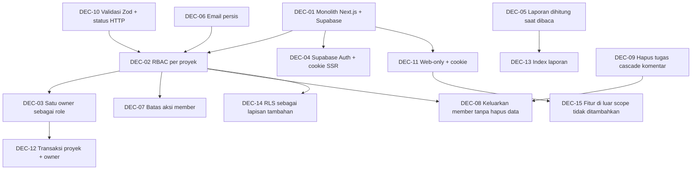

# DECISIONS.md — KerjaTim

| Field | Nilai |
|---|---|
| Dokumen | DECISIONS.md |
| Produk | KerjaTim |
| Sumber kebenaran | SpecModel proyek KerjaTim |
| Ruang lingkup | MVP web app: autentikasi email/password, proyek, anggota, tugas, komentar, laporan mingguan |
| Entity | `profiles`, `projects`, `project_members`, `tasks`, `comments` |
| Endpoint | `EP-001`–`EP-015` |
| Requirement | `REQ-001`–`REQ-017`, `BR-001`–`BR-006` |
| Role | `owner`, `member` per proyek |
| Dependensi | `ARCHITECTURE.md`, `DATABASE.md`, `API.md`, `SECURITY.md`, `REQUIREMENTS.md`, `BUSINESS_RULES.md` |

Dokumen ini mencatat keputusan arsitektur dan alasan di baliknya. Keputusan di sini menjelaskan cara SpecModel diimplementasikan; dokumen ini tidak menambah entity, endpoint, role, requirement, atau aturan produk baru. ID kanonik yang dipakai adalah `REQ-001`–`REQ-017`, `EP-001`–`EP-015`, dan `BR-001`–`BR-006`. Jika terjadi konflik antara dokumen ini dan SpecModel, SpecModel adalah sumber kebenaran.

## 1. Decision Log

| ID | Keputusan | Status | Referensi |
|---|---|---|---|
| DEC-01 | Gunakan Next.js App Router full-stack sebagai modular monolith; UI, Route Handlers/Server Actions, validasi, otorisasi, dan akses data berada dalam satu deployment. | Diterima | `EP-001`–`EP-015`, `REQ-015` |
| DEC-02 | Simpan role per proyek di `project_members`; setiap request terproteksi memverifikasi `project_id` dan `user_id` dari sesi di server. | Diterima | `REQ-015`, `BR-002`, `EP-007`, `EP-011`–`EP-015` |
| DEC-03 | Modelkan tepat satu owner sebagai `project_members.role = 'owner'`; tidak ada `projects.owner_id`; transfer kepemilikan dilakukan atomik. | Diterima | `BR-001`, `REQ-009`, `EP-008` |
| DEC-04 | Gunakan Supabase Auth email/password dengan cookie SSR; reset password melalui email Supabase Auth/Resend; aplikasi tidak menyimpan token reset sendiri. | Diterima | `REQ-001`–`REQ-003`, `EP-001`–`EP-004` |
| DEC-05 | Hitung laporan mingguan saat dibaca dari `tasks`; tidak ada tabel snapshot; status memakai `is_completed` terkini; periode Senin–Minggu. | Diterima | `REQ-014`, `BR-005`, `EP-015` |
| DEC-06 | Tambah member hanya dengan pencocokan `profiles.email` persis; tidak ada daftar pengguna atau pencarian sebagian. | Diterima | `REQ-007`, `BR-006`, `EP-009` |
| DEC-07 | Batasi member pada perubahan `is_completed` untuk tugas dengan `assignee_id` dirinya; owner mengubah semua field dan menghapus tugas. | Diterima | `REQ-011`, `REQ-012`, `BR-003`, `EP-012`, `EP-013` |
| DEC-08 | Keluarkan member dengan menghapus baris `project_members`; `tasks` dan `comments` tetap ada; nama penulis dibaca dari `profiles`. | Diterima | `REQ-008`, `BR-004`, `EP-010` |
| DEC-09 | Hapus tugas menghapus komentar terkait; tidak ada soft delete pada MVP. | Diterima | `REQ-012`, `EP-013` |
| DEC-10 | Validasi semua input di server dengan Zod dan gunakan status HTTP konsisten: `400`, `401`, `403`, `404`, `409`, `200`, `201`, `202`, `204`. | Diterima | `REQ-001`, `REQ-006`, `REQ-010`, `REQ-013`, `EP-001`–`EP-015` |
| DEC-11 | Layani web app saja dengan sesi cookie server; tidak ada API publik terpisah, token bearer, atau klien mobile pada MVP. | Diterima | `REQ-002`, `EP-001`–`EP-015` |
| DEC-12 | Gunakan skema PostgreSQL ternormalisasi dengan foreign key; pembuatan proyek dan baris owner dibuat dalam satu transaksi. | Diterima | `REQ-004`, `EP-006`, `BR-001` |
| DEC-13 | Tambahkan index untuk lookup keanggotaan, daftar tugas per proyek, laporan mingguan, komentar kronologis, dan pencocokan email persis. | Diterima | `EP-005`, `EP-007`, `EP-009`, `EP-015`, `REQ-007`, `REQ-014` |
| DEC-14 | Aktifkan RLS Supabase sebagai lapisan pertahanan tambahan; guard aplikasi di server tetap wajib dan tidak digantikan RLS. | Diterima | `REQ-015` |
| DEC-15 | Jangan menambahkan pembayaran, notifikasi, lampiran file, integrasi pihak ketiga, undangan email, atau multi-workspace pada MVP. | Diterima | Tidak ada entity/endpoint terkait di SpecModel |

## 2. Architecture Decisions

Diagram berikut menunjukkan ketergantungan keputusan, bukan aliran data produksi.



### 2.1 DEC-01 — Modular monolith Next.js dan Supabase

**Keputusan.** UI, Route Handlers/Server Actions, validasi Zod, otorisasi, dan akses data berada dalam satu aplikasi Next.js App Router. PostgreSQL dan Auth memakai Supabase. Email reset password dikirim melalui Supabase Auth dan Resend. Tidak ada backend service terpisah, queue, worker, atau endpoint di luar `EP-001`–`EP-015`.

**Alasan.** Untuk MVP tim kecil, jumlah layanan dan biaya awal harus minimal. Satu framework full-stack mempercepat implementasi halaman, form, dan mutasi. Cookie SSR `@supabase/ssr` menghindari penyimpanan token di client. PostgreSQL relasional cukup untuk `projects`, `project_members`, `tasks`, dan `comments`, termasuk laporan mingguan sederhana.

**Konsekuensi.** Deployment tunggal di Vercel; UI dan server saling terikat; scaling mengikuti platform. Server Actions yang dipakai form UI wajib memanggil service domain dan authorization guard yang sama seperti Route Handlers, sehingga tidak ada jalur alternatif yang melewati otorisasi. Service role key hanya boleh berada di environment server.

**Verifikasi.** Build dan deploy hanya menghasilkan satu aplikasi. Tidak ada request ke backend lain selain Supabase Auth/PostgreSQL dan Resend. `EP-001`–`EP-015` dilayani oleh Route Handlers/Server Actions.

### 2.2 DEC-02 — RBAC per proyek di `project_members`

**Keputusan.** Role `owner` dan `member` disimpan per baris `project_members`, bukan sebagai role global di `profiles`. Setiap endpoint terproteksi membaca `user_id` dari sesi dan memverifikasi baris `project_members` untuk `project_id` yang diminta. Untuk endpoint tugas dan komentar, `project_id` diturunkan dari `task_id`, bukan dari body request.

**Alasan.** `BR-002` menyatakan satu pengguna dapat menjadi owner di satu proyek dan member di proyek lain. Role dari client tidak boleh dipercaya. Menurunkan `project_id` dari resource mencegah IDOR, misalnya member proyek A mengirim `task_id` proyek B.

**Konsekuensi.** Setiap request terproteksi membutuhkan query keanggotaan. Perubahan role dan pengeluaran member berlaku pada request berikutnya karena role tidak di-cache di sesi. Non-anggota mendapat `403`; pengguna tanpa sesi mendapat `401`. RLS Supabase hanya lapisan tambahan, bukan pengganti guard aplikasi.

**Verifikasi.** Member proyek A tidak dapat mengakses `EP-007`, `EP-011`–`EP-015` milik proyek B. Body yang mengirim `role`, `owner_id`, `author_id`, atau `user_id` pelaku tidak mengubah hasil otorisasi.

### 2.3 DEC-03 — Satu owner per proyek sebagai role

**Keputusan.** Tepat satu baris `project_members` dengan `role = 'owner'` per proyek. `projects` tidak memiliki kolom `owner_id`. Transfer kepemilikan melalui `EP-008`: owner lama menjadi `member`, target menjadi `owner`, dalam satu transaksi. Owner tidak dapat mengeluarkan dirinya sendiri melalui `EP-010`; kepemilikan harus dialihkan terlebih dahulu.

**Alasan.** `BR-001` membutuhkan satu sumber kebenaran untuk kepemilikan. Kolom `owner_id` di `projects` akan menciptakan dua sumber kebenaran dan memperbesar risiko transfer parsial. Transaksi menjaga invariant tepat satu owner.

**Konsekuensi.** Diperlukan partial unique index pada `project_members(project_id)` untuk `role = 'owner'` agar maksimum satu owner dapat dijaga database. Invariant minimum satu owner dijaga alur aplikasi: `EP-006` membuat proyek bersama owner, `EP-010` melarang owner mengeluarkan diri sendiri, dan `EP-008` selalu menghasilkan owner baru. Saat transfer, owner lama harus diturunkan menjadi `member` sebelum target dinaikkan menjadi `owner` agar constraint tidak bentrok. Kegagalan di tengah transaksi harus rollback.

**Verifikasi.** Dua baris owner pada proyek yang sama ditolak. Setelah `EP-008`, jumlah owner tetap satu dan owner lama berubah menjadi member. `new_owner_id` yang bukan member aktif ditolak. Member yang mencoba `EP-008` mendapat `403`.

```mermaid
sequenceDiagram
    actor O as Owner
    participant UI as Web UI
    participant API as EP-008
    participant G as Authorization Guard
    participant DB as PostgreSQL

    O->>UI: Pilih member sebagai new_owner_id
    UI->>API: PATCH /api/projects/{project_id}
    API->>G: Baca sesi dan cek role owner
    G->>DB: SELECT project_members WHERE project_id, user_id
    DB-->>G: role = owner
    G-->>API: aktor diizinkan

    API->>G: Validasi new_owner_id adalah member aktif
    G->>DB: SELECT project_members target
    DB-->>G: member aktif

    alt new_owner_id bukan member aktif atau aktor bukan owner
        API-->>UI: penolakan; tidak ada perubahan
    else valid
        API->>DB: BEGIN
        API->>DB: UPDATE owner lama menjadi member
        API->>DB: UPDATE new_owner_id menjadi owner
        API->>DB: COMMIT
        DB-->>API: tepat satu owner
        API-->>UI: 200 proyek terbarui
    end

    UI-->>O: tampilkan owner baru
```

### 2.4 DEC-04 — Supabase Auth dan reset password

**Keputusan.** Signup, login, logout, dan reset password memakai Supabase Auth. Aplikasi tidak menyimpan password. Sesi dikirim sebagai cookie HttpOnly, Secure, dan SameSite=Lax; token tidak dikembalikan di body response dan tidak disimpan di `localStorage`. `EP-004` selalu mengembalikan `202` dengan pesan netral, baik email terdaftar maupun tidak. Aplikasi tidak menyimpan token reset sendiri.

**Alasan.** Alur autentikasi dan reset password adalah area berisiko tinggi. Menggunakan Supabase Auth mengurangi permukaan keamanan dan memanfaatkan alur reset yang sudah teruji. Cookie SSR menghindari eksposur token ke JavaScript.

**Konsekuensi.** Verifikasi email saat signup belum diputuskan; lihat Open Questions. Deliverability email bergantung pada Supabase Auth dan Resend. Rate limiting untuk `EP-002` dan `EP-004` belum ditetapkan; lihat Open Questions. Logout melalui `EP-003` menghapus cookie sesi dan halaman terproteksi mengalihkan pengguna ke login.

**Verifikasi.** Kredensial salah menghasilkan `401` tanpa sesi. Logout menghasilkan `204` dan cookie sesi dihapus. Permintaan reset untuk email tidak terdaftar tetap menghasilkan `202` netral. Setelah reset berhasil, password lama tidak berlaku.

### 2.5 DEC-05 — Laporan mingguan dihitung saat dibaca

**Keputusan.** `EP-015` menghitung laporan langsung dari `tasks`. Filter yang dipakai adalah `project_id` dan kondisi `created_at` atau `updated_at` berada dalam periode Senin–Minggu. Hasil dikelompokkan berdasarkan `is_completed` terkini. Tidak ada tabel `weekly_reports`, cron, atau snapshot terjadwal.

**Alasan.** Ini sesuai keputusan SpecModel dan menghindari snapshot status historis yang tidak diminta. Query tetap sederhana karena hanya membaca satu tabel `tasks`. Laporan selalu mencerminkan status terkini saat dibuka.

**Konsekuensi.** Laporan tidak menyimpan histori status; jika status tugas berubah setelah minggu berjalan, laporan minggu tersebut ikut berubah. Tugas yang dibuat dan diperbarui pada minggu yang sama dihitung sekali. Zona waktu default belum ditetapkan; lihat Open Questions. Diperlukan index pada `tasks(project_id, created_at)` dan `tasks(project_id, updated_at)`.

**Verifikasi.** Tugas yang dibuat di luar periode tetapi diperbarui di dalam periode muncul. Tugas yang dibuat dan diperbarui di minggu yang sama tidak terduplikasi. Non-anggota yang memanggil `EP-015` mendapat `403`.

### 2.6 DEC-11 — Web-only dan sesi cookie

**Keputusan.** KerjaTim hanya melayani web app dengan sesi cookie server. Tidak ada API publik terpisah, token bearer, atau klien mobile pada MVP. Semua endpoint terproteksi memakai cookie sesi yang sama.

**Alasan.** Jawaban interview menetapkan web app saja. Satu klien dan satu mekanisme sesi mengurangi kompleksitas autentikasi, CORS, dan rotasi token. SSR Next.js cocok dengan cookie HttpOnly.

**Konsekuensi.** Klien non-browser memerlukan perubahan arsitektur autentikasi. API publik tidak tersedia untuk integrasi pihak ketiga. Fokus pengujian berada pada browser dan Route Handlers/Server Actions.

**Verifikasi.** Respons login tidak mengandung token di body. Endpoint terproteksi mengembalikan `401` tanpa cookie sesi yang valid.

## 3. Data Decisions

Skema mengikuti entity SpecModel. Nama field di bawah sama dengan SpecModel; index dan constraint adalah keputusan implementasi untuk mendukung endpoint dan aturan bisnis.

### 3.1 `profiles`

- Field: `id` uuid, `email` text, `display_name` text, `created_at` timestamp.
- Primary key: `id`. Nilai `id` sama dengan `auth.users.id` Supabase.
- Constraint: `email` wajib, unik, dan tidak null; `display_name` wajib dan tidak null; `created_at` wajib.
- Index: unique index pada `email` untuk pencocokan persis `EP-009`.
- Tidak ada kolom role di `profiles`. Role hanya ada di `project_members` sesuai `BR-002`.
- Verifikasi: email duplikat ditolak; `EP-009` mencocokkan email lengkap, bukan sebagian.

### 3.2 `projects`

- Field: `id` uuid, `name` text, `description` text, `created_at` timestamp, `updated_at` timestamp.
- Primary key: `id`.
- Constraint: `name` wajib dan tidak boleh string kosong; `description` wajib tetapi boleh string kosong; timestamp wajib.
- Tidak ada `owner_id`. Kepemilikan dibaca dari `project_members` dengan `role = 'owner'`.
- Index: primary key cukup; daftar proyek per pengguna dilayani index `project_members(user_id)`.
- Verifikasi: `EP-006` dengan `name` kosong ditolak `400`; `EP-008` memperbarui `updated_at`.

### 3.3 `project_members`

- Field: `id` uuid, `project_id` uuid, `user_id` uuid, `role` text, `joined_at` timestamp.
- Primary key: `id`.
- Foreign key: `project_id` ke `projects.id`; `user_id` ke `profiles.id`.
- Constraint: unique `(project_id, user_id)` mencegah duplikasi keanggotaan; `role` hanya `owner` atau `member`; partial unique index pada `(project_id)` untuk `role = 'owner'` menjamin maksimum satu owner per proyek.
- Index: unique `(project_id, user_id)` untuk guard; index `user_id` untuk `EP-005`.
- Verifikasi: menambah user yang sama dua kali ke proyek yang sama ditolak; member kedua dengan role owner ditolak database.

### 3.4 `tasks`

- Field: `id` uuid, `project_id` uuid, `title` text, `description` text, `assignee_id` uuid, `is_completed` boolean, `created_at` timestamp, `updated_at` timestamp.
- Primary key: `id`.
- Foreign key: `project_id` ke `projects.id`; `assignee_id` ke `profiles.id`.
- Constraint: `title` wajib; `description` wajib tetapi boleh string kosong; `assignee_id` wajib; `is_completed` wajib dengan default `false`; timestamp wajib.
- Tidak ada foreign key dari `assignee_id` ke `project_members`. Alasannya, `BR-004` menyatakan tugas tetap ada setelah member dikeluarkan, sehingga tugas dapat tetap menunjuk profil mantan member sampai owner mengganti assignee. Validasi bahwa assignee adalah anggota proyek dilakukan di server pada `EP-011` dan `EP-012`.
- Index: `tasks(project_id)` untuk daftar tugas `EP-007`; `tasks(project_id, is_completed)` untuk filter status; `tasks(assignee_id)` untuk kebutuhan `REQ-017` saat dipromosikan; `tasks(project_id, created_at)` dan `tasks(project_id, updated_at)` untuk `EP-015`.
- Verifikasi: `assignee_id` bukan anggota proyek ditolak `400`; `is_completed` berubah memperbarui `updated_at`; tugas tetap ada setelah `EP-010`.

### 3.5 `comments`

- Field: `id` uuid, `task_id` uuid, `author_id` uuid, `body` text, `created_at` timestamp.
- Primary key: `id`.
- Foreign key: `task_id` ke `tasks.id` dengan `ON DELETE CASCADE`; `author_id` ke `profiles.id`.
- Constraint: `body` wajib dan tidak boleh kosong; `created_at` wajib.
- Index: `comments(task_id, created_at)` untuk menampilkan komentar kronologis pada `EP-007`.
- Verifikasi: `body` kosong ditolak `400`; menghapus tugas melalui `EP-013` menghapus komentar terkait; komentar tetap menampilkan `display_name` penulis setelah penulis dikeluarkan dari proyek.

### 3.6 Relasi, transaksi, dan lifecycle

- `profiles` 1–N `project_members`; `projects` 1–N `project_members`.
- `projects` 1–N `tasks`; `profiles` 1–N `tasks` sebagai `assignee_id`.
- `tasks` 1–N `comments`; `profiles` 1–N `comments` sebagai `author_id`.
- `EP-006` membuat proyek dan baris `project_members` role owner dalam satu transaksi.
- `EP-008` melakukan transfer kepemilikan dalam satu transaksi; owner lama menjadi member, target menjadi owner, dan kegagalan rollback.
- `EP-010` hanya menghapus baris `project_members`; tidak ada cascade ke `tasks` atau `comments` sesuai `BR-004`.
- `EP-013` menghapus tugas dan komentar terkait.
- Tidak ada tabel `weekly_reports`; laporan dibaca dari `tasks` sesuai DEC-05.
- Kolom timestamp mengikuti tipe di SpecModel. Interpretasi zona waktu untuk periode laporan masih ada di Open Questions.

## 4. Security Decisions

Urutan pemeriksaan pada endpoint terproteksi: sesi, keanggotaan proyek, role, allowlist field, lalu validasi Zod. Untuk `EP-012`, `EP-013`, dan `EP-014`, `project_id` diturunkan dari `task_id` untuk mencegah akses lintas proyek.

| Operasi | Anonim | Login non-anggota | Member | Owner |
|---|---|---|---|---|
| `EP-007` GET detail proyek | `401` | `403` | `200` | `200` |
| `EP-008` PATCH proyek/transfer | `401` | `403` | `403` | `200` |
| `EP-009` POST member | `401` | `403` | `403` | `201` |
| `EP-010` DELETE member | `401` | `403` | `403` | `204`; ditolak untuk diri sendiri |
| `EP-011` POST task | `401` | `403` | `201` | `201` |
| `EP-012` PATCH task | `401` | `403` | `200` hanya `is_completed` untuk tugas sendiri | `200` semua field |
| `EP-013` DELETE task | `401` | `403` | `403` | `204` |
| `EP-014` POST comment | `401` | `403` | `201` | `201` |
| `EP-015` GET laporan mingguan | `401` | `403` | `200` | `200` |

`EP-005` tidak memakai parameter proyek dari client; endpoint mengembalikan proyek tempat pengguna login menjadi anggota. `EP-001`, `EP-002`, dan `EP-004` bersifat publik; `EP-003` membutuhkan sesi dan mengembalikan `204`.

### 4.1 Sesi dan cookie

- `EP-002` membuat cookie sesi; `EP-003` menghapusnya.
- Cookie wajib HttpOnly, Secure, dan SameSite=Lax. Token tidak disimpan di `localStorage` dan tidak dikembalikan di body.
- Tanpa sesi pada endpoint `auth: true`, respons adalah `401`.
- Verifikasi: pengguna yang logout tidak dapat mengakses `EP-005`–`EP-015` dengan cookie lama.

### 4.2 Otorisasi per proyek

- Server membaca `user_id` dari sesi, bukan dari body.
- Server memuat `project_members` berdasarkan `project_id` dan `user_id`; ketiadaan baris berarti `403`.
- Role `owner` dan `member` tidak pernah diterima dari client.
- `EP-012` member hanya boleh mengirim `is_completed`; jika `assignee_id` tugas bukan dirinya, respons `403` sesuai `BR-003`.
- `EP-013` hanya owner; member mendapat `403`.
- Verifikasi: matriks aktor di atas diuji untuk setiap endpoint dengan sesi member, owner, non-anggota, dan tanpa sesi.

### 4.3 Allowlist field

- `EP-001`: `email`, `password`, `display_name`.
- `EP-002`: `email`, `password`.
- `EP-004`: `email`.
- `EP-006`: `name`, `description`.
- `EP-008`: `name`, `description`, `new_owner_id`.
- `EP-009`: `email`.
- `EP-011`: `title`, `description`, `assignee_id`.
- `EP-012`: `title`, `description`, `assignee_id`, `is_completed`; untuk member hanya `is_completed`.
- `EP-014`: `body`.

Field `role`, `owner_id`, `author_id`, dan `user_id` pelaku tidak diterima dari client. `assignee_id` wajib merujuk anggota proyek. `new_owner_id` wajib merujuk member aktif proyek.

### 4.4 Transfer kepemilikan dan pengeluaran member

- `EP-008` hanya untuk owner; target harus member aktif; hasil akhir tepat satu owner.
- `EP-010` tidak boleh menghapus owner sendiri; owner harus mentransfer kepemilikan terlebih dahulu.
- Setelah `EP-010`, mantan member kehilangan akses ke `EP-007`, `EP-011`–`EP-015` karena guard membaca `project_members` pada setiap request.
- `tasks` dan `comments` tidak dihapus; nama penulis komentar tetap tampil dari `profiles` sesuai `BR-004`.
- Verifikasi: mantan member mendapat `403` pada resource proyek, tetapi komentar historis masih menampilkan `display_name`.

### 4.5 Reset password dan enumerasi akun

- `EP-004` selalu `202` dengan pesan netral.
- Aplikasi tidak menyimpan token reset; tautan dikirim melalui Supabase Auth dan Resend.
- `EP-001` mengembalikan `409` untuk email duplikat dan `EP-009` mengembalikan `404`/`409` hanya kepada owner. Ini adalah konsekuensi kontrak API; rate limiting dan kontrol anti-abuse belum ditetapkan.
- Verifikasi: email tidak terdaftar pada `EP-004` tidak membocorkan status akun.

### 4.6 RLS dan secret

- RLS Supabase harus mencerminkan keanggotaan proyek, tetapi guard aplikasi tetap wajib.
- Service role key dan Resend API key hanya berada di environment server; tidak boleh masuk client, repo, atau log.
- Query memakai Supabase client, bukan string SQL yang disusun dari input pengguna.
- Output React di-escape; aplikasi tidak merender HTML mentah dari komentar, nama proyek, atau `display_name`.
- Verifikasi: akses langsung dengan anon key tidak dapat membaca proyek yang bukan haknya; tidak ada secret di bundle client.

## 5. Tradeoffs

| Area | Keputusan | Keuntungan | Biaya/risiko | Referensi |
|---|---|---|---|---|
| Arsitektur | Modular monolith Next.js + Supabase | Sedikit layanan, deploy cepat, biaya awal rendah | UI dan server terikat; scaling mengikuti platform; satu failure domain | DEC-01, `EP-001`–`EP-015` |
| Managed platform | Supabase Auth/PostgreSQL dan Resend | Auth, database, dan email reset terkelola | Lock-in ringan; batas free tier; kustomisasi terbatas | DEC-01, DEC-04 |
| Kepemilikan | Owner sebagai role di `project_members` | Satu sumber kebenaran; transfer atomik | Guard butuh join; transfer lebih rumit; partial unique index | `BR-001`, `REQ-009` |
| Laporan | Dihitung saat dibaca | Sederhana; tidak ada snapshot basi | Tidak ada histori status; query bisa berat saat data besar | `BR-005`, `REQ-014` |
| Hak member | Hanya status tugas sendiri | Mengurangi perusakan data dan manipulasi laporan | Member tidak dapat memperbaiki konten; beban owner lebih tinggi | `BR-003`, `REQ-011` |
| Pengeluaran member | Hapus keanggotaan, pertahankan data | Histori komentar utuh; audit sosial tetap ada | Tugas dapat tetap menunjuk mantan member; owner harus reassign manual | `BR-004`, `REQ-008` |
| Penambahan member | Email persis, tanpa direktori pengguna | Privasi lebih baik; permukaan data kecil | Owner harus tahu email lengkap; `404` dapat dipakai owner untuk menguji email | `BR-006`, `REQ-007` |
| Notifikasi | Tidak termasuk MVP | Scope terkendali | Anggota tidak menerima notifikasi tugas baru; adopsi dapat terhambat | DEC-15 |
| Pagination, rate limiting, audit | Belum ditetapkan pada MVP | Implementasi sederhana | Risiko penyalahgunaan free tier; tidak ada jejak forensik persisten | Open Questions |

Tradeoff yang paling berpengaruh adalah kepemilikan proyek. Menyimpan owner sebagai role menghilangkan duplikasi data, tetapi membuat transfer kepemilikan dan pengeluaran owner harus melalui transaksi yang hati-hati. Keputusan ini tetap diambil karena `BR-001` dan `BR-002` menuntut role per proyek sebagai dasar otorisasi.

Tradeoff kedua adalah laporan mingguan tanpa snapshot. Laporan selalu segar dan tidak memerlukan cron, tetapi tidak dapat menjawab pertanyaan “bagaimana status tugas pada akhir minggu lalu” jika status berubah setelahnya. Jika kebutuhan histori muncul, keputusan ini harus ditinjau ulang; lihat Revisit Triggers.

## 6. Revisit Triggers

| Trigger | Kondisi | Keputusan yang ditinjau | Tindakan |
|---|---|---|---|
| Zona waktu laporan ditetapkan | Produk memilih zona waktu default, misalnya Asia/Jakarta | DEC-05, `BR-005`, `EP-015` | Perbarui query periode, test batas Senin–Minggu, dan dokumentasi API |
| Verifikasi email diputuskan | Supabase email confirmation diaktifkan atau dimatikan | DEC-04, `REQ-001`, `EP-001` | Sesuaikan alur signup, pembuatan `profiles`, dan pesan login |
| Komentar perlu diedit/dihapus | Muncul kebutuhan mengubah `comments.body` | `REQ-013`, `comments` | Perlu requirement dan endpoint baru di luar `EP-001`–`EP-015` sebelum implementasi |
| Assignee mantan member perlu diputuskan | Owner mengeluarkan member yang masih memiliki tugas terbuka | DEC-08, `BR-004`, `EP-010` | Pilih tetap terbuka atau otomatis dilepas; jika otomatis, perlu transaksi dan aturan baru |
| Fitur di luar scope diminta | Notifikasi, lampiran, pembayaran, integrasi, undangan email, atau multi-workspace masuk backlog | DEC-15 | Perlu entity, endpoint, requirement, dan threat model baru; jangan menambah sebagian tanpa SpecModel |
| `REQ-016` atau `REQ-017` dipromosikan | Search/filter atau ringkasan tugas pribadi menjadi MVP | DEC-13, `EP-007` | Verifikasi index `tasks(assignee_id)` dan filter status; `REQ-017` memerlukan endpoint baru di luar SpecModel saat ini |
| Volume data meningkat | `EP-015` atau `EP-007` melambat, respons membesar | DEC-05, DEC-13 | Tambah index, pagination, atau snapshot jika SpecModel diperbarui |
| Batas free tier tercapai | Kuota Supabase, Vercel, atau Resend terlampaui | DEC-01, DEC-04 | Evaluasi upgrade atau migrasi; perbarui keputusan deployment |
| Klien kedua dibutuhkan | Mobile app atau API publik diminta | DEC-11, DEC-04 | Tinjau mekanisme sesi/token dan kontrak API; saat ini cookie web-only |
| Kebutuhan multi-owner atau workspace muncul | Satu proyek perlu lebih dari satu owner | DEC-03, `BR-001` | Ubah model kepemilikan dan partial unique index; perlu requirement baru |
| Kebutuhan audit/compliance muncul | Aksi destruktif owner perlu jejak persisten | DEC-15 | Perlu entity audit baru; belum ada di SpecModel |
| Penyalahgunaan terdeteksi | Brute force `EP-002`/`EP-004` atau lonjakan request | DEC-04, DEC-10 | Tetapkan rate limiting, token CSRF terpisah, dan CSP; perbarui SECURITY |

## 7. Open Questions

1. **Zona waktu laporan mingguan.** Default belum ditetapkan; usulan Asia/Jakarta perlu dikonfirmasi. Ini memengaruhi `EP-015` dan `BR-005`.
2. **Verifikasi email.** Apakah Supabase email confirmation diaktifkan saat signup, atau akun langsung aktif setelah `EP-001`? Ini memengaruhi `REQ-001`, `EP-001`, dan `EP-002`.
3. **Edit/hapus komentar.** Apakah `comments.body` boleh diubah atau dihapus, atau komentar bersifat permanen pada MVP? SpecModel belum memiliki endpoint untuk itu.
4. **Assignee mantan member.** Jika member dikeluarkan melalui `EP-010`, apakah tugas yang masih menunjuk dirinya tetap terbuka sampai owner mengganti `assignee_id`, atau otomatis dilepas? `BR-004` baru menetapkan bahwa data tetap ada.
5. **Kontrol anti-abuse.** Rate limiting untuk `EP-002`/`EP-004`, token CSRF terpisah, dan CSP belum ditetapkan. SameSite=Lax dan metode mutasi non-GET adalah kontrol awal, bukan solusi lengkap.
6. **Batas input dan pagination.** Batas panjang `comments.body`, `projects.name`, `projects.description`, `tasks.title`, `tasks.description`, serta pagination respons `EP-005`/`EP-007` belum ditetapkan.