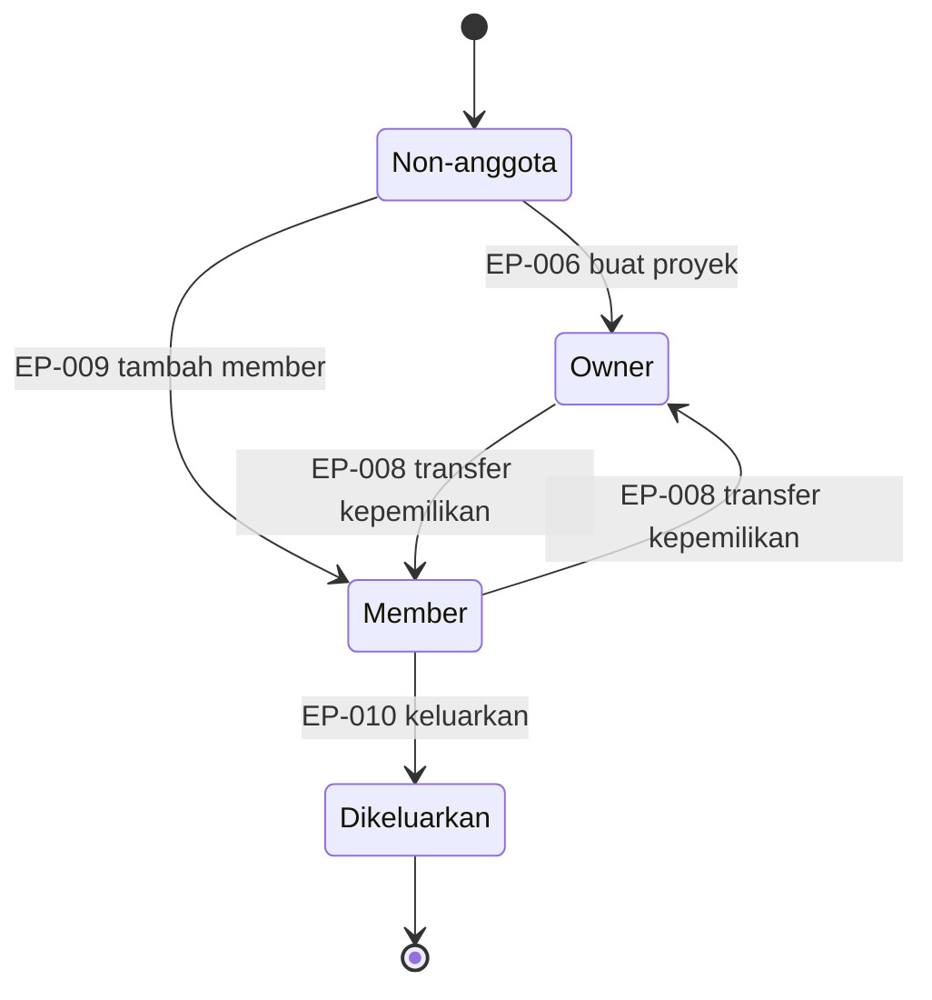
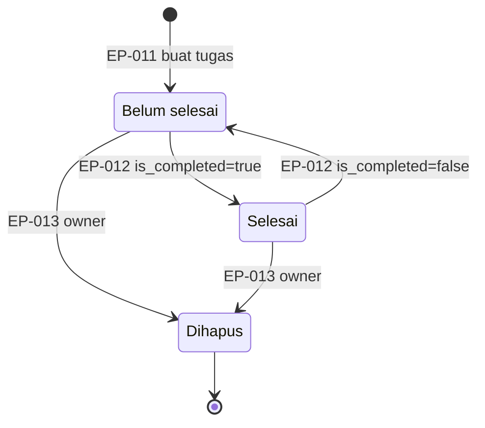

# USER_FLOW.md — KerjaTim

| Field | Nilai |
|---|---|
| Nama dokumen | USER_FLOW.md |
| Produk | KerjaTim |
| Versi | 1.0 |
| Status | Siap untuk review |
| Sumber kebenaran | SpecModel proyek KerjaTim |
| Cakupan | Aktor, primary flow, alternative flow, error & edge case, state transition |
| Platform | Web app; Next.js App Router + Supabase Auth cookie SSR |

Dokumen ini memetakan alur aktor, cabang alternatif, kondisi gagal, dan transisi state pada produk KerjaTim. Seluruh ID yang dipakai adalah ID kanonik dari SpecModel: `REQ-xxx`, `EP-xxx`, `BR-xxx`, serta nama entity `profiles`, `projects`, `project_members`, `tasks`, dan `comments`. Dokumen ini tidak menambahkan entity, endpoint, role, requirement, atau aturan bisnis baru. Jika terjadi konflik antara dokumen ini dan SpecModel, SpecModel menang.

## 1. Actors

SpecModel hanya mendefinisikan dua role produk: `owner` dan `member`, dan keduanya berlaku **per proyek** (`BR-002`). Selain role, dokumen ini membedakan konteks akses yang memengaruhi perilaku sistem: pengguna tanpa sesi dan pengguna login yang bukan anggota proyek. Keduanya bukan role, melainkan kondisi sesi/keanggotaan.

| Aktor | Definisi | Cara memperoleh | Batasan utama |
|---|---|---|---|
| Pengguna tanpa sesi | Pengunjung yang belum login atau sudah logout | Default saat tidak ada cookie sesi valid | Hanya boleh mengakses `EP-001`, `EP-002`, `EP-004`; endpoint lain menghasilkan `401` (`REQ-015`) |
| Pengguna terautentikasi | Pengguna dengan sesi cookie valid dan baris `profiles` | `EP-001` lalu `EP-002` | Dapat membuat proyek (`EP-006`) dan otomatis menjadi owner di proyek tersebut (`REQ-004`) |
| Owner | Anggota proyek dengan `project_members.role = owner` | Pembuat proyek, atau penerima transfer kepemilikan | Tepat satu owner per proyek (`BR-001`); tidak dapat mengeluarkan dirinya sendiri (`REQ-008`) |
| Member | Anggota proyek dengan `project_members.role = member` | Ditambahkan owner via email persis (`EP-009`) | Hanya boleh mengubah `is_completed` pada tugas dengan `assignee_id` miliknya (`BR-003`) |
| Non-anggota | Pengguna login yang tidak memiliki baris `project_members` pada proyek terkait | Kondisi default bagi proyek yang tidak diikuti | Setiap akses ke `EP-007`–`EP-015` menghasilkan `403` (`REQ-015`) |
| Sistem | Server Next.js Route Handlers/Server Actions + pemeriksaan `project_members` | — | Menegakkan otorisasi di server, bukan di client (nonFunctional, `REQ-015`) |

### 1.1 Matriks kewenangan per aksi

| Aksi | Owner | Member | Endpoint | Rujukan |
|---|---|---|---|---|
| Registrasi, login, logout, minta reset password | Berlaku untuk semua pengguna (tidak per proyek) | Berlaku untuk semua pengguna | `EP-001`–`EP-004` | `REQ-001`–`REQ-003` |
| Melihat daftar proyek yang diikuti | Ya | Ya | `EP-005` | `REQ-005` |
| Membuat proyek baru | Pelaku menjadi owner proyek baru | Pelaku menjadi owner proyek baru | `EP-006` | `REQ-004` |
| Melihat detail proyek, anggota, tugas, komentar | Ya | Ya | `EP-007` | `REQ-005` |
| Mengubah `name`/`description` proyek | Ya | Tidak (`403`) | `EP-008` | `REQ-006` |
| Mengalihkan kepemilikan | Ya | Tidak (`403`) | `EP-008` | `REQ-009` |
| Menambah member | Ya | Tidak (`403`) | `EP-009` | `REQ-007` |
| Mengeluarkan member | Ya | Tidak (`403`) | `EP-010` | `REQ-008` |
| Membuat tugas | Ya | Ya | `EP-011` | `REQ-010` |
| Mengubah `title`, `description`, `assignee_id` | Ya | Tidak (`403`) | `EP-012` | `REQ-011`, `BR-003` |
| Mengubah `is_completed` tugas miliknya | Ya | Ya | `EP-012` | `REQ-011`, `BR-003` |
| Mengubah `is_completed` tugas anggota lain | Ya | Tidak (`403`) | `EP-012` | `BR-003` |
| Menghapus tugas | Ya | Tidak (`403`) | `EP-013` | `REQ-012` |
| Menambah komentar | Ya | Ya | `EP-014` | `REQ-013` |
| Melihat laporan mingguan | Ya | Ya | `EP-015` | `REQ-014` |

## 2. Primary Flows

Setiap flow di bawah ini adalah jalur sukses (happy path). Penyimpangan dibahas pada Bagian 3, kegagalan validasi dan otorisasi pada Bagian 4.

| ID | Nama flow | Aktor | Endpoint utama | Requirement |
|---|---|---|---|---|
| PF-01 | Registrasi akun | Pengguna tanpa sesi | `EP-001` | `REQ-001` |
| PF-02 | Login | Pengguna tanpa sesi | `EP-002` | `REQ-002` |
| PF-03 | Logout | Pengguna terautentikasi | `EP-003` | `REQ-002` |
| PF-04 | Reset password | Pengguna tanpa sesi | `EP-004` | `REQ-003` |
| PF-05 | Melihat daftar proyek | Pengguna terautentikasi | `EP-005` | `REQ-005` |
| PF-06 | Membuat proyek | Pengguna terautentikasi | `EP-006` | `REQ-004` |
| PF-07 | Melihat detail proyek | Owner, Member | `EP-007` | `REQ-005` |
| PF-08 | Mengubah nama/deskripsi proyek | Owner | `EP-008` | `REQ-006` |
| PF-09 | Menambah member | Owner | `EP-009` | `REQ-007` |
| PF-10 | Mengeluarkan member | Owner | `EP-010` | `REQ-008` |
| PF-11 | Mengalihkan kepemilikan | Owner | `EP-008` | `REQ-009` |
| PF-12 | Membuat tugas | Owner, Member | `EP-011` | `REQ-010` |
| PF-13 | Mengubah tugas (owner) | Owner | `EP-012` | `REQ-011` |
| PF-14 | Mengubah status tugas (member) | Member | `EP-012` | `REQ-011`, `BR-003` |
| PF-15 | Menghapus tugas | Owner | `EP-013` | `REQ-012` |
| PF-16 | Berkomentar pada tugas | Owner, Member | `EP-014` | `REQ-013` |
| PF-17 | Melihat laporan mingguan | Owner, Member | `EP-015` | `REQ-014` |

### PF-01 — Registrasi akun
- **Aktor:** Pengguna tanpa sesi.
- **Prasyarat:** Tidak ada sesi aktif.
- **Langkah:**
  1. Pengguna membuka halaman signup dan mengisi `email`, `password`, serta `display_name`.
  2. Server memvalidasi input dengan Zod: format email valid, password minimal 8 karakter, `display_name` terisi.
  3. Server membuat akun Supabase Auth, lalu menyimpan profil aplikasi (`profiles.id` = `auth.users.id`, `email`, `display_name`, `created_at`).
  4. Sistem mengembalikan `201` berisi user id, email, dan `display_name`.
- **Hasil:** Akun dan `profiles` terbentuk; pengguna diarahkan ke login.
- **Rujukan:** `EP-001`, `REQ-001`.

### PF-02 — Login
- **Aktor:** Pengguna tanpa sesi.
- **Prasyarat:** Akun terdaftar.
- **Langkah:**
  1. Pengguna mengisi `email` dan `password`.
  2. Server memverifikasi kredensial ke Supabase Auth.
  3. Server membuat sesi cookie `HttpOnly`, `Secure`, `SameSite=Lax` dan mengembalikan `200` berisi user.
  4. Pengguna diarahkan ke halaman daftar proyek (`EP-005`).
- **Hasil:** Sesi aktif; seluruh endpoint terproteksi dapat dipanggil.
- **Rujukan:** `EP-002`, `REQ-002`.

### PF-03 — Logout
- **Aktor:** Pengguna terautentikasi.
- **Langkah:**
  1. Pengguna memicu logout dari navigasi.
  2. Server menghapus cookie sesi dan mengembalikan `204`.
  3. Permintaan berikutnya ke halaman/endpoint terproteksi dialihkan ke login.
- **Rujukan:** `EP-003`, `REQ-002`.

### PF-04 — Reset password
- **Aktor:** Pengguna tanpa sesi.
- **Langkah:**
  1. Pengguna membuka halaman lupa password dan mengirim `email`.
  2. Server meminta Supabase Auth mengirim tautan reset; aplikasi tidak menyimpan token reset sendiri.
  3. Server mengembalikan `202` dengan pesan netral, terlepas dari status keterdaftaran email.
  4. Pengguna membuka tautan di email, menetapkan password baru melalui alur Supabase Auth.
  5. Pengguna login kembali dengan password baru dan diarahkan ke daftar proyek.
- **Hasil:** Password lama tidak berlaku; sesi baru terbentuk setelah login.
- **Catatan cakupan:** Tidak ada endpoint aplikasi tambahan di luar `EP-004` pada `EP-001`–`EP-015`; penetapan password baru ditangani Supabase Auth.
- **Rujukan:** `EP-004`, `REQ-003`.

### PF-05 — Melihat daftar proyek
- **Aktor:** Pengguna terautentikasi.
- **Langkah:**
  1. Server membaca `user_id` dari sesi cookie.
  2. Server mengambil baris `project_members` milik pengguna dan `projects` terkait.
  3. Respons `200` memuat `id`, `name`, `description`, `role` pengguna, dan `member_count` per proyek.
  4. UI menampilkan kartu proyek; hanya proyek tempat pengguna menjadi anggota yang tampil.
- **Rujukan:** `EP-005`, `REQ-005`, `BR-002`.

### PF-06 — Membuat proyek
- **Aktor:** Pengguna terautentikasi (berpotensi member di proyek lain).
- **Langkah:**
  1. Pengguna membuka form proyek baru dan mengisi `name` (wajib) dan `description` (opsional, boleh string kosong).
  2. Server memvalidasi `name` tidak kosong.
  3. Server menyimpan `projects` dan membuat baris `project_members` dengan `role = owner` untuk pembuat, dalam satu alur.
  4. Respons `201` mengembalikan proyek baru; proyek muncul di `EP-005`.
- **Hasil:** Proyek memiliki tepat satu owner.
- **Rujukan:** `EP-006`, `REQ-004`, `BR-001`.

### PF-07 — Melihat detail proyek
- **Aktor:** Owner atau Member proyek tersebut.
- **Langkah:**
  1. Pengguna membuka proyek dari daftar; klien memanggil `EP-007` dengan `project_id`.
  2. Server memeriksa baris `project_members` untuk `(project_id, user_id)`.
  3. Respons `200` memuat `project`, `members`, dan `tasks` beserta `comments` kronologis.
  4. UI menampilkan daftar tugas dengan status `is_completed` dan penanggung jawab terbaru.
- **Rujukan:** `EP-007`, `REQ-005`.

### PF-08 — Mengubah nama/deskripsi proyek
- **Aktor:** Owner.
- **Langkah:**
  1. Owner membuka pengaturan proyek dan mengubah `name` dan/atau `description`.
  2. Server memverifikasi `project_members.role = owner` untuk proyek tersebut.
  3. Server memvalidasi `name` tidak kosong, memperbarui `projects`, dan menyesuaikan `updated_at`.
  4. Respons `200` mengembalikan proyek terbarui.
- **Rujukan:** `EP-008`, `REQ-006`.

### PF-09 — Menambah member
- **Aktor:** Owner.
- **Langkah:**
  1. Owner membuka pengaturan anggota dan mengetik email lengkap calon member.
  2. Server memverifikasi owner proyek.
  3. Server mencocokkan `profiles.email` secara persis; sistem tidak menampilkan daftar pengguna dan tidak mendukung pencarian sebagian.
  4. Jika akun ditemukan dan belum menjadi anggota, server membuat baris `project_members` dengan `role = member` dan `joined_at`.
  5. Respons `201` mengembalikan member baru; member langsung dapat mengakses `EP-007`.
- **Rujukan:** `EP-009`, `REQ-007`, `BR-006`.

### PF-10 — Mengeluarkan member
- **Aktor:** Owner.
- **Langkah:**
  1. Owner memilih member pada daftar anggota dan memicu pengeluaran.
  2. Server memverifikasi owner dan memastikan target bukan dirinya sendiri.
  3. Server menghapus baris `project_members` milik target; baris `tasks` dan `comments` tidak diubah.
  4. Respons `204`; mantan member kehilangan akses, nama penulis komentar tetap tampil dari `profiles`.
- **Rujukan:** `EP-010`, `REQ-008`, `BR-004`.

### PF-11 — Mengalihkan kepemilikan
- **Aktor:** Owner.
- **Langkah:**
  1. Owner memilih `new_owner_id` dari anggota proyek.
  2. Server memverifikasi pelaku adalah owner dan target adalah anggota proyek.
  3. Dalam satu transaksi: `role` owner lama menjadi `member`, `role` target menjadi `owner`.
  4. Respons `200`; tepat satu owner tercatat setelah transaksi.
  5. Owner lama tetap menjadi anggota dan dapat mengakses proyek sebagai member.
- **Rujukan:** `EP-008`, `REQ-009`, `BR-001`.

### PF-12 — Membuat tugas
- **Aktor:** Owner atau Member.
- **Langkah:**
  1. Anggota proyek membuka detail proyek dan mengisi `title`, `description`, serta `assignee_id`.
  2. Server memverifikasi pelaku adalah anggota proyek.
  3. Server memverifikasi `assignee_id` adalah anggota proyek yang sama.
  4. Server menyimpan `tasks` dengan `is_completed = false` dan `updated_at` awal.
  5. Respons `201`; tugas muncul pada daftar tugas proyek.
- **Rujukan:** `EP-011`, `REQ-010`.

### PF-13 — Mengubah tugas (owner)
- **Aktor:** Owner.
- **Langkah:**
  1. Owner membuka tugas dan mengubah salah satu atau semua field: `title`, `description`, `assignee_id`, `is_completed`.
  2. Server memverifikasi pelaku owner proyek pemilik tugas.
  3. Jika `assignee_id` berubah, server memverifikasi target adalah anggota proyek.
  4. Server menyimpan perubahan dan memperbarui `updated_at`.
  5. Respons `200`; daftar tugas dan laporan mingguan mencerminkan nilai terbaru.
- **Rujukan:** `EP-012`, `REQ-011`.

### PF-14 — Mengubah status tugas (member)
- **Aktor:** Member yang ditugaskan.
- **Prasyarat:** `tasks.assignee_id` sama dengan `user_id` pelaku.
- **Langkah:**
  1. Member membuka tugasnya dan menandai selesai atau belum selesai.
  2. Klien hanya mengirim `is_completed`.
  3. Server memverifikasi keanggotaan, lalu memverifikasi `is_completed` adalah satu-satunya field yang dikirim dan `assignee_id` milik pelaku.
  4. Server menyimpan perubahan dan memperbarui `updated_at`.
  5. Respons `200`; status tampil pada daftar tugas dan laporan mingguan.
- **Rujukan:** `EP-012`, `REQ-011`, `BR-003`.

### PF-15 — Menghapus tugas
- **Aktor:** Owner.
- **Langkah:**
  1. Owner memicu hapus pada sebuah tugas dan mengonfirmasi.
  2. Server memverifikasi pelaku owner proyek pemilik tugas.
  3. Server menghapus `tasks` beserta `comments` terkait.
  4. Respons `204`; tugas dan komentarnya tidak lagi tampil di detail proyek maupun laporan mingguan.
- **Rujukan:** `EP-013`, `REQ-012`.

### PF-16 — Berkomentar pada tugas
- **Aktor:** Owner atau Member.
- **Langkah:**
  1. Anggota proyek membuka tugas dari detail proyek; komentar tampil kronologis dengan `display_name` dan `created_at`.
  2. Anggota menulis `body` dan mengirimkannya.
  3. Server memverifikasi keanggotaan proyek pemilik tugas dan `body` tidak kosong.
  4. Server menyimpan `comments` dengan `author_id` dari sesi.
  5. Respons `201`; komentar baru tampil pada urutan kronologis.
- **Rujukan:** `EP-014`, `REQ-013`.

### PF-17 — Melihat laporan mingguan
- **Aktor:** Owner atau Member.
- **Langkah:**
  1. Anggota proyek membuka tab laporan mingguan.
  2. Anggota memilih `week_start` berformat `YYYY-MM-DD` yang merupakan hari Senin.
  3. Server memverifikasi keanggotaan proyek.
  4. Server mengambil tugas dengan `created_at` atau `updated_at` di dalam periode Senin–Minggu, lalu mengelompokkannya berdasarkan `is_completed` terkini.
  5. Respons `200` memuat `week_start`, `week_end`, `completed_tasks`, dan `incomplete_tasks`.
- **Rujukan:** `EP-015`, `REQ-014`, `BR-005`.

## 3. Alternative Flows

| ID | Memicu dari | Kondisi | Perilaku sistem | Endpoint | Rujukan |
|---|---|---|---|---|---|
| AF-01 | PF-01 | Email sudah terdaftar | Permintaan ditolak `409`; tidak ada akun baru dibuat | `EP-001` | `REQ-001` |
| AF-02 | PF-01 | Email tidak valid, password < 8 karakter, atau `display_name` kosong | Ditolak `400` dengan pesan validasi; tidak ada akun dibuat | `EP-001` | `REQ-001` |
| AF-03 | PF-02 | Kredensial salah | `401`; tidak ada sesi dibuat; pengguna tetap di halaman login | `EP-002` | `REQ-002` |
| AF-04 | PF-04 | Email tidak terdaftar | Tetap `202` dengan pesan netral; tidak membocorkan status akun | `EP-004` | `REQ-003` |
| AF-05 | PF-04 | Login memakai password lama setelah reset berhasil | `401`; password lama tidak berlaku | `EP-002` | `REQ-003` |
| AF-06 | PF-05–PF-17 | Tidak ada sesi valid atau sesi kedaluwarsa | `401`; UI mengalihkan ke login | Semua endpoint `auth: true` | `REQ-015` |
| AF-07 | PF-07 | Pelaku bukan anggota proyek | Ditolak `403` (SpecModel juga mengizinkan `404`); tidak ada data proyek yang dikirim | `EP-007` | `REQ-005` |
| AF-08 | PF-08 | Member mencoba mengubah proyek | Ditolak `403` | `EP-008` | `REQ-006` |
| AF-09 | PF-08 | `name` kosong | Ditolak `400` | `EP-008` | `REQ-006` |
| AF-10 | PF-09 | Email tidak cocok dengan `profiles.email` mana pun | `404`; tidak ada anggota ditambahkan | `EP-009` | `REQ-007`, `BR-006` |
| AF-11 | PF-09 | Email cocok tetapi sudah menjadi anggota proyek | `409`; baris `project_members` tidak diduplikasi | `EP-009` | `REQ-007` |
| AF-12 | PF-09, PF-10, PF-11 | Pelaku adalah member, bukan owner | Ditolak `403` | `EP-009`, `EP-010`, `EP-008` | `REQ-015` |
| AF-13 | PF-10 | Owner mencoba mengeluarkan dirinya sendiri | Ditolak; kepemilikan harus dialihkan lebih dulu | `EP-010` | `REQ-008` |
| AF-14 | PF-11 | `new_owner_id` bukan anggota proyek | Ditolak; tidak ada perubahan role | `EP-008` | `REQ-009` |
| AF-15 | PF-11 | Proyek hanya memiliki owner tanpa member lain | Transfer tidak dapat dilakukan karena tidak ada kandidat anggota aktif; owner harus menambah member lebih dulu | `EP-008`, `EP-009` | `REQ-009`, `BR-001` |
| AF-16 | PF-12 | `assignee_id` bukan anggota proyek | Ditolak `400`; tugas tidak dibuat | `EP-011` | `REQ-010` |
| AF-17 | PF-12 | Pelaku bukan anggota proyek | Ditolak `403` | `EP-011` | `REQ-015` |
| AF-18 | PF-14 | Member mengirim field selain `is_completed` | Ditolak `403`; tidak ada field yang berubah | `EP-012` | `BR-003` |
| AF-19 | PF-14 | Member mengubah status tugas dengan `assignee_id` milik anggota lain | Ditolak `403` | `EP-012` | `BR-003` |
| AF-20 | PF-13 | Owner mengganti `assignee_id` ke anggota lain | `200`; member sebelumnya kehilangan hak mengubah status tugas tersebut, dan penerima baru memperolehnya | `EP-012` | `REQ-011`, `BR-003` |
| AF-21 | PF-15 | Member mencoba menghapus tugas | Ditolak `403`; tugas tetap ada | `EP-013` | `REQ-012` |
| AF-22 | PF-16 | `body` kosong atau hanya whitespace | Ditolak `400`; komentar tidak disimpan | `EP-014` | `REQ-013` |
| AF-23 | PF-16 | Non-anggota mencoba berkomentar | Ditolak `403` | `EP-014` | `REQ-013` |
| AF-24 | PF-17 | `week_start` bukan hari Senin atau format bukan `YYYY-MM-DD` | Permintaan ditolak validasi; kode status spesifik belum ditetapkan pada SpecModel (lihat Open Questions) | `EP-015` | `REQ-014` |
| AF-25 | PF-17 | Tidak ada tugas pada periode terpilih | `200` dengan `completed_tasks` dan `incomplete_tasks` kosong; bukan error | `EP-015` | `REQ-014` |
| AF-26 | PF-17 | Non-anggota membuka laporan | Ditolak `403` | `EP-015` | `REQ-014` |

## 4. Error & Edge Cases

### 4.1 Matriks status error per endpoint

| Endpoint | 400 | 401 | 403 | 404 | 409 |
|---|---|---|---|---|---|
| `EP-001` POST signup | Validasi input | — | — | — | Email terdaftar |
| `EP-002` POST login | Body tidak valid | Kredensial salah | — | — | — |
| `EP-003` POST logout | — | Sesi tidak ada | — | — | — |
| `EP-004` POST forgot password | Email tidak valid | — | — | — | — |
| `EP-005` GET projects | — | Ya | — | — | — |
| `EP-006` POST projects | `name` kosong | Ya | — | — | — |
| `EP-007` GET project detail | — | Ya | Bukan anggota | — | — |
| `EP-008` PATCH project | `name` kosong | Ya | Bukan owner | — | — |
| `EP-009` POST member | Email tidak valid | Ya | Bukan owner | Email tidak ditemukan | Sudah menjadi anggota |
| `EP-010` DELETE member | — | Ya | Bukan owner; owner mengeluarkan diri sendiri | — | — |
| `EP-011` POST task | Assignee bukan anggota | Ya | Bukan anggota | — | — |
| `EP-012` PATCH task | — | Ya | Di luar batas role (`BR-003`) | — | — |
| `EP-013` DELETE task | — | Ya | Bukan owner | — | — |
| `EP-014` POST comment | `body` kosong | Ya | Bukan anggota | — | — |
| `EP-015` GET weekly report | `week_start` tidak valid | Ya | Bukan anggota | — | — |

Prinsip pembeda: `401` berarti identitas tidak terbukti (sesi tidak ada/kedaluwarsa), `403` berarti identitas terbukti tetapi aksi di luar hak pada proyek tersebut, `404` pada `EP-009` berarti email tidak ditemukan, dan `409` berarti konflik keadaan (email sudah terdaftar atau sudah menjadi anggota).

### 4.2 Edge case

| ID | Edge case | Dampak | Penanganan sesuai SpecModel |
|---|---|---|---|
| EC-01 | Dua transfer kepemilikan dipicu bersamaan | Risiko dua owner atau nol owner | Transfer wajib atomik; kondisi dua owner ditolak (`BR-001`) |
| EC-02 | Tugas dibuat pada minggu A dan diperbarui pada minggu B | Tugas muncul pada laporan minggu A dan minggu B | Konsekuensi langsung `BR-005`; bukan duplikasi data |
| EC-03 | Tugas dibuat dan diperbarui pada minggu yang sama | Tugas hanya dihitung satu kali | `BR-005` menegaskan tugas dihitung sekali per periode |
| EC-04 | Tugas dihapus padahal memiliki komentar | Komentar kehilangan induk | `EP-013` menghapus tugas beserta komentar terkait |
| EC-05 | Member dikeluarkan dari proyek | Kehilangan akses ke proyek, tugas, dan komentar | Baris `project_members` dihapus; `tasks` dan `comments` tetap ada; `display_name` tetap tampil dari `profiles` (`BR-004`, `REQ-008`) |
| EC-06 | Owner ingin keluar dari proyek | Owner tidak dapat mengeluarkan dirinya sendiri | Harus mengalihkan kepemilikan lebih dulu ke member aktif (`REQ-008`, `REQ-009`) |
| EC-07 | Proyek hanya berisi owner | Tidak ada kandidat penerima transfer | Owner harus menambah member via `EP-009` sebelum transfer (`REQ-009`) |
| EC-08 | Tugas masih menunjuk assignee yang sudah dikeluarkan | Assignee tidak dapat mengubah status karena bukan anggota (`403` pada `EP-012`) | Tugas tetap terbuka; owner perlu menetapkan ulang `assignee_id` via `EP-012` (lihat Open Questions) |
| EC-09 | Owner mengganti assignee tugas yang sedang dikerjakan member | Member lama kehilangan hak ubah status | `EP-012` member hanya berlaku untuk `assignee_id` miliknya (`BR-003`) |
| EC-10 | Non-anggota menebak `project_id` atau `task_id` | Potensi kebocoran data lintas proyek | Setiap endpoint memeriksa `project_members` di server (`REQ-015`); RLS Supabase sebagai lapisan tambahan |
| EC-11 | Batas periode minggu jatuh tepat pada Senin 00:00 | Tugas dapat masuk/keluar periode berbeda | Zona waktu belum ditetapkan; lihat Open Questions dan `BR-005` |
| EC-12 | Sesi kedaluwarsa saat pengguna mengisi form | Data form dapat hilang | Server mengembalikan `401`; UI mengarahkan ke login (`REQ-002`) |
| EC-13 | Komentar perlu dikoreksi setelah dikirim | Tidak ada mekanisme koreksi pada MVP | Belum ada endpoint edit/hapus komentar di `EP-001`–`EP-015` (lihat Open Questions) |
| EC-14 | Email ditulis dengan kapitalisasi berbeda saat menambah member | Pencocokan dapat gagal walau akun ada | Sistem hanya mencocokkan persis (`BR-006`); sensitivitas kapitalisasi lihat Open Questions |
| EC-15 | Laporan diminta untuk minggu jauh di masa depan | Tidak ada data | `200` dengan kedua daftar kosong (AF-25) |

## 5. State Transitions

### 5.1 State sesi dan akun

| Dari | Peristiwa | Ke | Endpoint | Rujukan |
|---|---|---|---|---|
| Tanpa sesi | Signup berhasil | Terautentikasi (akun aktif, belum login) | `EP-001` | `REQ-001` |
| Tanpa sesi | Login berhasil | Sesi aktif | `EP-002` | `REQ-002` |
| Sesi aktif | Logout | Tanpa sesi | `EP-003` | `REQ-002` |
| Sesi aktif | Sesi kedaluwarsa / cookie dihapus | Tanpa sesi | — | `REQ-015` |
| Tanpa sesi | Minta reset password | Permintaan reset terkirim (pesan netral) | `EP-004` | `REQ-003` |
| Permintaan reset terkirim | Menetapkan password baru via tautan | Password diperbarui, belum login | Supabase Auth | `REQ-003` |

### 5.2 State keanggotaan proyek

| Dari | Peristiwa | Ke | Guard | Endpoint |
|---|---|---|---|---|
| Non-anggota | Membuat proyek | Owner | Pengguna login | `EP-006` |
| Non-anggota | Ditambahkan owner | Member | Email cocok persis dan belum menjadi anggota | `EP-009` |
| Member | Menerima transfer kepemilikan | Owner | Pelaku owner; target anggota aktif; transaksi atomik | `EP-008` |
| Owner | Mengalihkan kepemilikan | Member | Target anggota aktif; tepat satu owner setelah transaksi | `EP-008` |
| Member | Dikeluarkan owner | Dikeluarkan | Target bukan owner | `EP-010` |
| Owner | Mencoba keluar sendiri | Owner (tidak berubah) | Ditolak; harus transfer dulu | `EP-010` |

Catatan: tidak ada transisi `Owner → Dikeluarkan`. Owner hanya dapat berhenti menjadi owner melalui transfer kepemilikan (`BR-001`, `REQ-008`).

### 5.3 State tugas

| Dari | Peristiwa | Ke | Siapa yang boleh | Efek samping |
|---|---|---|---|---|
| — | Membuat tugas | Belum selesai (`is_completed = false`) | Owner, Member | `assignee_id` harus anggota proyek; `created_at` dan `updated_at` terisi |
| Belum selesai | Menandai selesai | Selesai | Owner; Member hanya jika `assignee_id` miliknya | `updated_at` diperbarui; tugas masuk `completed_tasks` pada laporan |
| Selesai | Menandai belum selesai | Belum selesai | Owner; Member hanya jika `assignee_id` miliknya | `updated_at` diperbarui; tugas masuk `incomplete_tasks` |
| Belum selesai / Selesai | Menghapus tugas | Dihapus | Owner | Komentar terkait ikut terhapus (`EP-013`) |
| Belum selesai / Selesai | Mengganti `assignee_id` | State tetap, pemilik hak ubah status berubah | Owner | Member lama tidak lagi dapat mengubah status (`BR-003`) |
| Belum selesai / Selesai | Mengubah `title`/`description` | State tetap | Owner | `updated_at` berubah sehingga tugas dapat berpindah periode laporan (`BR-005`) |

### 5.4 State komentar dan proyek

| Entitas | Transisi | Pemicu | Catatan |
|---|---|---|---|
| `comments` | Tidak ada → tersimpan | `EP-014` | Kronologis berdasarkan `created_at`; penulis dan waktu selalu ditampilkan (`REQ-013`) |
| `comments` | Tersimpan → dihapus | `EP-013` (hapus tugas induk) | Tidak ada penghapusan komentar individual pada MVP |
| `projects` | Aktif → terbarui | `EP-008` | `updated_at` berubah |
| `projects` | Aktif selama memiliki tepat satu owner | `EP-006`, `EP-008` | Tidak ada status arsip atau hapus proyek di SpecModel |

## 6. Open Questions

Pertanyaan berikut belum diputuskan pada SpecModel dan tidak boleh dijawab sebagai fakta di dokumen lain. Setiap butir menyertakan dampak dan usulan yang masih perlu dikonfirmasi.

1. **Zona waktu laporan mingguan.** SpecModel menyebut periode Senin–Minggu pada "zona waktu yang disepakati" tetapi belum menetapkan nilainya. Dampak: penentuan batas `created_at`/`updated_at` pada `EP-015`. Usulan untuk dikonfirmasi: `Asia/Jakarta`.
2. **Verifikasi email saat signup.** Belum ditetapkan apakah Supabase Auth mengirim verifikasi email atau akun langsung aktif setelah `EP-001`. Dampak: apakah pengguna dapat langsung login pada PF-02.
3. **Edit atau hapus komentar.** Belum ada endpoint perubahan/penghapusan komentar pada `EP-001`–`EP-015`. Dampak: komentar bersifat permanen kecuali tugas induk dihapus via `EP-013`.
4. **Tugas yang masih menunjuk mantan member.** Belum ditetapkan apakah tugas tetap terbuka sampai owner mengganti `assignee_id`, atau ada perlakuan lain. Dampak: status pekerjaan pada laporan mingguan dan daftar tugas (`BR-004`).
5. **Kode status untuk penolakan tertentu.** SpecModel belum menetapkan kode status untuk: owner mengeluarkan dirinya sendiri (`EP-010`), `new_owner_id` bukan anggota (`EP-008`), dan `week_start` bukan hari Senin (`EP-015`). Dampak: konsistensi kontrak error dan pengujian.
6. **Sensitivitas kapitalisasi email pada `EP-009`.** "Pencocokan persis" belum menjelaskan apakah `Budi@example.com` cocok dengan `budi@example.com`. Dampak: keberhasilan PF-09 dan konsistensi `409`/`404`.
7. **Penambahan ulang mantan member.** Karena baris `project_members` dihapus (`BR-004`), pengguna tersebut tidak lagi memenuhi kondisi `409` "sudah menjadi anggota". Perlu konfirmasi apakah penambahan ulang diperbolehkan tanpa batasan.
8. **Atomisitas signup.** Belum ditetapkan perilaku bila akun Supabase Auth berhasil dibuat tetapi penyimpanan `profiles` gagal. Dampak: kemungkinan akun tanpa profil yang membuat `display_name` tidak tersedia.
9. **Pilihan `403` atau `404` untuk non-anggota pada `EP-007`.** SpecModel mengizinkan keduanya. Dampak: konsistensi perilaku dan pengujian keamanan lintas proyek.